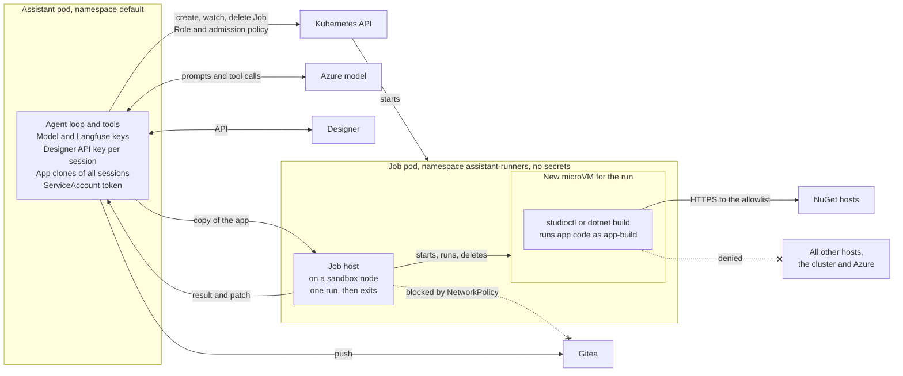

# Isolate assistant tools that can run code

- Status: Proposed
- Deciders: Team
- Date: 13.10.2026

## Result

A4: The assistant creates one Kubernetes Job for each run of a tool that runs code from the app repository. The Job pod runs on a sandbox node, starts one new microVM for the run, answers the assistant and exits. The pod has no secrets, and the VM can reach only the NuGet hosts.

## Problem context

The Studio assistant needs two tools that run code from the app repository:

- `studioctl app upgrade v9` upgrades a v8 app to v9. It restores the app and loads its project.
- `dotnet build` checks that the C# code of the app compiles.

When the .NET build tools restore, load or build a project, they run code that the repository controls: `<Exec>` targets, inline tasks, and the targets, analyzers and source generators of NuGet packages. The user and the model can change the repository, and an uploaded document can try to make the model write such code.

The assistant pod is not a safe place for this code. The pod runs as root, and it holds:

- the Azure model key and the Langfuse keys;
- the Designer API key of each active session (one chat conversation with the assistant), which can push to Gitea for
  20 minutes;
- the clones of the app repositories of all active sessions.

## Decision drivers

- B1: Code from an app repository cannot read the secrets of the assistant, or the repositories and keys of other
  sessions.
- B2: The assistant can upgrade apps to v9 and check that C# code compiles.
- B3: A job cannot stop the assistant, for example when it uses all the memory.
- B4: When more people use the assistant, more jobs can run at the same time.
- B5: No runner holds capacity on the sandbox nodes while nobody runs a job.
- B6: Nice to have: few new parts to build and operate.

## Alternatives considered

- A1: Keep the assistant as it is. Do not add tools that run code from the app repository.
- A2: Change the assistant service so that all tools run in an isolated environment in the same pod.
- A3: Run the tools that run code from the app repository in an always-on runner service in a separate pod, with a new
  microVM for each job.
- A4: Run the tools that run code from the app repository in a separate pod: one Kubernetes Job for each run, with a new
  microVM in it.

## Pros and cons

### A1: Keep the assistant as it is

- Good, because nothing changes and there is no new risk (B1, B3, B5, B6).
- Bad, because the assistant cannot upgrade apps or check that C# code compiles (B2).
  - The user must run `studioctl` on their own computer.
  - The assistant can commit C# code that does not compile.

### A2: Isolated environment in the same pod

- Good, because there is no new service or deployment (B6).
- Bad, because the job and the secrets share one kernel and one pod. A kernel bug or a mistake in the isolation gives
  access to all secrets and all sessions (B1).
- Bad, because the assistant pod must run as root, or get extra capabilities, to start a process as a different user.
- Bad, because a job uses the memory and CPU of the assistant pod. A large restore can make the kernel stop the
  assistant, and then all active sessions stop (B3).
- Bad, because all tools must change to run through the isolated environment: the file tools, git and the validators
  (B6).
- Bad, because the jobs cannot scale independently of the assistant (B4).

### A3: Always-on runner service

- Good, because the runner pod has no secrets, and each job runs in a new microVM, as in A4 (B1).
- Good, because the assistant gets no Kubernetes permission.
- Good, because a job starts fast. The pod is already running, so only the VM starts.
- Bad, because the service allocates resources on a sandbox node at all times, also when nobody runs a job (B5).
- Bad, because a replica runs one job at a time. More capacity needs more replicas, and each replica costs the same when idle (B4, B5).
- Bad, because the runner needs its own Service, HTTP API and logic that holds the one job slot (B6).

### A4: One Job for each run, in a separate pod

- Good, because the pod has no secrets, no ServiceAccount token, and no network access to Designer or Gitea. The
  assistant sends a copy of the app and gets back a result and a patch (B1).
- Good, because each run gets a new pod and a new microVM with its own kernel (B1).
- Good, because the VM can reach only the NuGet hosts (B1).
- Good, because the runs use their own CPU and memory on the sandbox nodes (B3).
- Good, because it allows multiple runs at the same time (B4).
- Good, because no runner pod exists while nobody runs a job (B5).
- Bad, because each run waits for a pod to start. If no sandbox node is free, the run also waits for a new node.

## Consequences

The assistant service runs the agent loop, which calls the model and runs the tools that the model asks for. It holds
all keys and is the only part that pushes to Gitea. The runner holds no keys. It gets a copy of the app and gives back a
result and a patch.

For each run, the assistant creates a Job from a PodTemplate in the `assistant-runners` namespace. The pod runs on a
sandbox node. When it is Ready, the assistant sends the app as a tar archive over HTTP to the pod, and only the
assistant pods can reach it. The job host runs the command in a new microVM, answers with the result and a patch, and
exits. The assistant then deletes the Job.

Each command that runs app code is a fixed route in the job host, so the model never chooses the command. Each new tool
that runs code from the app, for example a tool that starts the app or runs its tests, goes to the runner.

If the model later gets a shell tool, for example through a coding harness, all its tools must run in a runner. That
runner must live for the whole session and keep the copy of the app, not only for one run. A4 can grow to this with one
Job for each session, but a new ADR must decide it.
