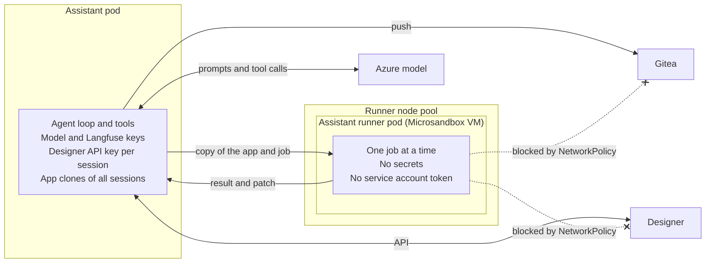

# Isolate assistant tools that can run code

- Status: Proposed
- Deciders: Team
- Date: 13.10.2026

## Result

A3: Tools that run code from the app repository run in a separate pod, the assistant runner. The pod runs in a Microsandbox and has no secrets.

## Problem context

The Studio assistant needs two tools that run code from the app repository:

- `studioctl app upgrade v9` upgrades a v8 app to v9. It restores the app and loads its project.
- `dotnet build` checks that the C# code of the app compiles.

When the .NET build tools restore, load or build a project, they run code that the repository controls: `<Exec>` targets, inline tasks, and the targets, analyzers and source generators of NuGet packages. The user and the model can change the repository, and an uploaded document can try to make the model write such code.

The assistant pod is not a safe place for this code. The pod runs as root, and it holds:

- the Azure model key and the Langfuse keys;
- the Designer API key of each active session (one chat conversation with the assistant), which can push to Gitea for
  20 minutes;
- the clones of the app repositories of all active sessions.

## Decision drivers

- B1: Code from an app repository cannot read the secrets of the assistant, or the repositories and keys of other
  sessions.
- B2: A job cannot change the result of a later job for a different user.
- B3: The assistant can upgrade apps to v9 and check that C# code compiles.
- B4: A job cannot stop the assistant, for example when it uses all the memory.
- B5: When more people use the assistant, more jobs can run at the same time.
- B6: Nice to have: few new parts to build and operate.

## Alternatives considered

- A1: Keep the assistant as it is. Do not add tools that run code from the app repository.
- A2: Change the assistant service so that all tools run in an isolated environment in the same pod.
- A3: Run the tools that run code from the app repository in a separate pod.

## Pros and cons

### A1: Keep the assistant as it is

- Good, because nothing changes and there is no new risk (B1, B2, B4, B6).
- Bad, because the assistant cannot upgrade apps or check that C# code compiles (B3).
  - The user must run `studioctl` on their own computer.
  - The assistant can commit C# code that does not compile.

### A2: Isolated environment in the same pod

- Good, because there is no new service or deployment (B6).
- Bad, because the job and the secrets share one kernel and one pod. A kernel bug or a mistake in the isolation gives access to all secrets and all sessions (B1).
- Bad, because the assistant pod must run as root, or get extra capabilities, to start a process as a different user.
- Bad, because a job uses the memory and CPU of the assistant pod. A large restore can make the kernel stop the assistant, and then all active sessions stop (B4).
- Bad, because all tools must change to run through the isolated environment: the file tools, git and the validators (B6).
- Bad, because the jobs cannot scale independently of the assistant (B5).

### A3: Separate pod

- Good, because the pod has no secrets, no service account token, and no network access to Designer or Gitea. The assistant sends a copy of the app and gets back a result and a patch (B1).
- Good, because the pod runs in a VM with its own kernel.
- Good, because each pod runs one job at a time, as a separate user, and removes all processes and files of the job before the next job (B2).
- Good, because the jobs use their own CPU and memory on the runner node pool (B4).
- Good, because more pods give more jobs at a time (B5).
- Bad, because there is a new service, image, namespace, NetworkPolicy and deploy workflow to maintain (B6).
- Bad, because the pods use capacity on the runner node pool, which the Gitea CI runners also use.

## Consequences

The assistant service runs the agent loop, which calls the model and runs the tools that the model asks for. It holds all keys and is the only part that pushes to Gitea. The runner holds no keys. It gets a copy of the app and gives back a result and a patch. Thus each new tool that runs code from the app, for example a tool that starts the app or runs its tests, goes to the runner.

If the model later gets a shell tool, for example through a coding harness, all its tools must run in the runner, and the runner must keep a copy of the app for each session. A3 is the only alternative that supports this, because it runs code from the app away from the keys of all sessions.
