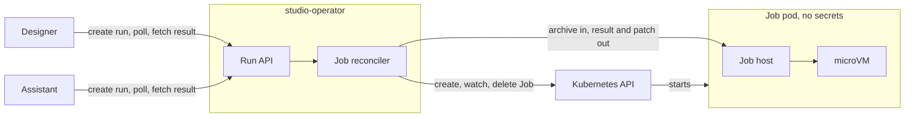

# Cluster work in a Studio cluster belongs to a studio operator

- Status: Proposed
- Deciders: Team
- Date: 28.10.2026

## Result

A3: Introduce a studio operator as the one Studio component in a Studio cluster that holds a Kubernetes client. Services that
need cluster work, such as running app code in a sandbox, ask the operator through an API. Services keep no Kubernetes
permission of their own. The heuristic below decides what the operator owns and what stays in the service that asks.

The accepted ADR [Isolate assistant tools that can run code](2026-10-13-assistant-code-running-tools.md) keeps its
isolation model: one Job for each run, a new microVM, a pod without secrets. The one part that changes is who creates
the Job.

## Problem context

A Studio cluster runs the control plane of Altinn Studio: Designer, Gitea with the app repositories, the assistant
and the supporting services in the [Studio syncroot](../../infra/studio/syncroot). The runtime clusters, where apps
run, have a settled shape for cluster work.

Cluster work is arriving in the Studio cluster from several directions at once:

- Running code from app repositories, for the assistant and for Designer. Such code needs a sandbox node and a
  microVM, and the accepted ADR for the assistant gives the assistant itself the permission to create the Jobs.
- Reconciling cluster resources from data outside Designer, such as the organization list, which lives in a
  CronJob of its own today.
- Scheduled work that Designer runs inside its own process.

The services that need cluster work are also the services that hold the most sensitive state. Designer holds every
developer session and the Gitea credentials. The assistant holds the model key, the Langfuse keys and a Designer API
key for each active session. Each Role granted to them is a Role next to those keys.

Without a rule, the next feature will put its Kubernetes client wherever its author sits, and the Studio cluster will
end up with several components that create pods, each with its own policy and quota.

## Decision drivers

- D1: Separation of privilege. A component that holds user sessions, API keys or model keys must not also hold the
  permission to create pods.
- D2: One path for a run. Quotas, timeouts, the catalog of commands and the sandbox pod spec exist once, and a caller
  passes arguments only.
- D3: The isolation model of the accepted ADR holds: no secrets in the pod, no ServiceAccount token, a new microVM for
  each run, egress only to an allowlist.
- D4: A run outlives the request that started it. It can be queued, cancelled, time out and be cleaned up when the
  caller is gone.
- D5: Domain logic stays in Designer, as the Go ADR decides. The component that runs cluster work never interprets an
  app, a release, a policy or a developer.
- D6: The rule must be usable by the next person who adds cluster work, without a new ADR for each case.
- D7: Nice to have: small, in the toolchain the team already uses for Kubernetes work, and operable by the squad that
  runs the other operators.

## Alternatives considered

- A1: Each service creates its own Jobs, as in the accepted ADR and the proof of concept.
- A2: Designer creates all Jobs and reconciles the cluster, and the assistant asks Designer.
- A3: A dedicated studio operator creates all Jobs and reconciles cluster resources, behind an HTTP API, with a
  heuristic for what it owns.

## Pros and cons

### A1: Each service creates its own Jobs

- Good, because there is no new deployment (D7).
- Bad, because each caller holds a Role in the runner namespace next to its keys (D1).
  - The proof of concept fences the assistant's Role with a policy and a quota, but the token that creates Jobs sits
    in the pod that also holds the model key.
- Bad, because the Job lifecycle, the quota handling and the policy binding are repeated in each caller's language (D2).
- Bad, because a run lives only as long as the caller's request. The job host stops the job when its client goes away,
  so a restart of the assistant fails every run in flight (D4).
- Bad, because it gives no rule for the next case. Reconciliation work such as `runner-org-sync` has no home in this
  model (D6).

### A2: Designer creates all Jobs and reconciles the cluster

- Good, because one place holds the permission, the catalog and the quotas (D2).
- Good, because Designer already tracks external runs that outlive a request. Quartz keeps each run in Postgres with
  clustering on, polls until the run is done and tells the developer. A Job run would reuse this pattern (D4).
- Good, because Designer knows the developer and the app behind every run, so per-developer and per-organization
  limits and the audit trail live next to the Job quota (D2).
- Good, because the assistant already calls Designer with an authenticated key. No new identity check and no new
  client in the assistant (D7).
- Bad, because Designer holds every developer session and the Gitea credentials. It is the component with the most to
  lose from a Kubernetes permission (D1).
- Bad, because the Go ADR, still proposed, puts services that speak to the Kubernetes API in Go. Designer would gain
  a Kubernetes client, informers and a Job reconciler inside a web API, and the runs would compete with requests for
  the same process (D5, D7).
- Bad, because Designer rolls out several times a day and the job host stops a run when its client goes away. Every
  Designer rollout fails the runs in flight (D4).
- Bad, because Designer runs two replicas in staging and prod. Quartz clustering shares out triggers, but a Job
  watcher needs leader election inside the web API (D4, D7).

### A3: A dedicated studio operator with a heuristic

- Good, because one service holds the Role for the runner namespace, plus the cluster-scoped grant that TokenReview
  needs. Designer and the assistant keep zero Kubernetes permission (D1).
- Good, because the catalog, the quotas and the timeouts exist once, and a caller passes a kind and arguments (D2).
- Good, because the pod spec and the microVM from the accepted ADR do not change. The admission policy, the network
  policy and the job host change their subject and their client, not their fencing (D3).
- Good, because the operator owns the run after the request returns. It queues, watches, times out and deletes, and a
  caller that restarts asks for the run by id. This holds once the job host no longer stops a run when its client
  goes away (D4).
- Good, because it is Go with controller-runtime, the stack of the runtime operator, owned by the same squad (D7).
- Bad, because it is a new deployment to build, run and page on, and a second controller-runtime code base to keep
  current next to the runtime operator (D7).
- Bad, because every run from every caller passes through the operator. With one replica, a restart of the operator
  fails all runs in flight, unless the job host changes so that a run survives its client (D4).
- Bad, because the operator does not own the sandbox capacity. The KEDA runner Jobs take the same KVM slots, so its
  quotas cannot promise that a run starts (D2).
- Bad, because absorbing `runner-org-sync` puts the Gitea admin token, which mints tokens for any organization, in
  the pod that also creates Jobs. Either that work stays out of the operator or it gets its own identity (D1).
- Bad, because the run API becomes a versioned contract between Go, C# and Python, deployed by separate workflows at
  different rates. Every change must stay backward compatible. This is a consequence outside the drivers.

## Decision heuristic

When a feature needs something from the Studio cluster, it belongs in the studio operator when:

- It needs the Kubernetes API: creating, watching or deleting pods, Jobs, secrets, config or scaled resources.
- It needs a sandbox node: running code that an app repository controls, or any code the caller did not write.
- It must outlive one request or one pod: queues, quotas, timeouts, retries and cleanup.
- It follows data that is not Designer's: the organization list, the state of the cluster, the capacity of the
  sandbox pool.

What does not meet one of these conditions stays in the service that needs it. The service owns the intent and the
record, the operator owns the run and the resources, and the run API is the seam.

## Technical design

The design lives with the code. The operator's README is the current state, and this section records only what the
decision fixes.

- **Name.** `studio-operator`, next to the existing `runtime-operator`. Image, module, workflow and syncroot entry use
  the qualified name.
- **Language.** Go with controller-runtime, by the heuristic in
  [Adopt Go for cloud-native runtime services and tooling](2025-10-17-using-go.md). The job host stays Rust, because
  the Sandbox SDK is Rust. This ADR does not decide language again.
- **Permission.** One Role, scoped to the runner namespace. Designer and the assistant mount no ServiceAccount token
  for the Kubernetes API. The ValidatingAdmissionPolicy from the accepted ADR keeps fencing every Job, with the
  operator as its subject.
- **Contract.** Callers create a run with a kind from a fixed catalog and arguments, poll it by id, fetch its result
  and cancel it. Callers never name a command. Callers authenticate with their projected ServiceAccount token, which
  the operator checks with TokenReview. No new secret exists.
- **Results** are not stored in Kubernetes objects.

## Appendix A: Who holds a Kubernetes client in the Studio cluster today

An inventory of the Studio components in this repository that hold a Role in a Studio cluster, deployed or proposed
in an open pull request at the date of this ADR. It is the state A3 replaces.

| Component                     | Permission                                    | Purpose                                    | After A3                    |
| ----------------------------- | --------------------------------------------- | ------------------------------------------ | --------------------------- |
| Assistant, proposed in #21410 | Create, watch, delete Jobs; read PodTemplate  | Run app upgrades in a sandbox              | Removed, asks the operator  |
| `runner-org-sync`             | Secrets and ConfigMap in `studio-runners`     | Gitea runner registration per organization | Moves into the operator     |
| Designer                      | None. Deploys through Azure DevOps            | Releases and deployments                   | Unchanged until builds move |
| Flux                          | Cluster admin                                 | Apply the syncroot                         | Unchanged                   |
