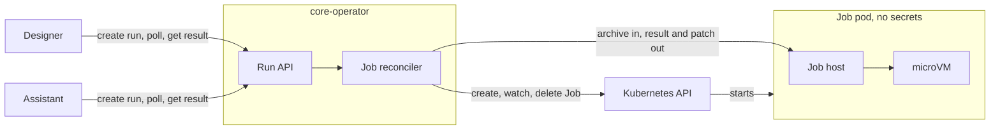

# A core operator does the work that continues after a request in a Studio cluster

- Status: Proposed
- Deciders: Team
- Date: 28.10.2026

## Result

A3: We add a core operator to the Studio cluster. The core operator does the work that continues after a request:
runs, reconciliation and, later, deployments. Kubernetes is one backend of the operator, not its definition. A
service that starts such work, for example a sandbox run of app code, sends a request to the operator through an
API.

The core operator is also the one Studio component that has a Kubernetes client. The services have no Kubernetes
permission. The conditions in "Conditions for operator work" tell you which work the operator does and which work
stays in the service.

The accepted ADR [Isolate assistant tools that can run code](2026-10-13-assistant-code-running-tools.md) continues
to apply. Each run has one Job, a new microVM and a pod without secrets. Only the component that creates the Job is
different.

## Problem context

A Studio cluster operates the control plane of Altinn Studio. The control plane includes Designer, Gitea with the
app repositories, the assistant and the support services in the [Studio syncroot](../../infra/studio/syncroot).
The runtime clusters, where the apps operate, have a structure for cluster work.

Cluster work comes to the Studio cluster from more than one direction:

- The assistant and Designer run code from app repositories. This code must run on a sandbox node in a microVM.
  The accepted ADR for the assistant gives the assistant the permission to create the Jobs.
- A component reconciles cluster resources from data that is not in Designer, for example the list of
  organizations. A separate CronJob does this work now.
- Designer starts work at specified times in the Designer process.

The services that start cluster work also keep the most important secrets. Designer keeps all the developer
sessions and the Gitea credentials. The assistant keeps the model key, the Langfuse keys and a Designer API key for
each active session. Each Role that these services get is a Role next to those secrets.

Without this decision, the next feature puts its Kubernetes client in the component where the person who writes it
works. The Studio cluster then gets many components that create pods. Each component has a different policy and a
different quota.

## Decision drivers

- D1: The permissions are separate. A component that keeps user sessions, API keys or model keys must not have
  the permission to create pods.
- D2: Each run uses one path. The quotas, the timeouts, the catalog of commands and the sandbox pod specification
  exist one time. A caller gives only arguments.
- D3: The isolation model of the accepted ADR continues to apply. The pod has no secrets and no ServiceAccount
  token. Each run has a new microVM. Egress goes only to an allowlist.
- D4: A run continues after the request that started it. The operator can put a run in a queue, cancel it, stop it
  after a timeout, and remove it when the caller is not available.
- D5: Domain logic stays in Designer, as the Go ADR specifies. The component that does cluster work does not know
  what an app, a release, a policy or a developer is.
- D6: The next person who adds cluster work can use this decision without a new ADR for each feature.
- D7: Nice to have: the component is small and uses the toolchain that the team uses for Kubernetes work. The
  squad that operates the other operators can operate it.

## Alternatives considered

- A1: Each service creates its Jobs. This is the model of the accepted ADR and of the proof of concept.
- A2: Designer creates all the Jobs and reconciles the cluster. The assistant sends its requests to Designer.
- A3: A core operator creates all the Jobs and reconciles the cluster resources. The operator has an HTTP API and
  conditions that tell you which work it does.

## Pros and cons

### A1: Each service creates its Jobs

- Good, because a new deployment is not necessary (D7).
- Bad, because each caller has a Role in the runner namespace, next to its keys (D1).
  - In the proof of concept, a policy and a quota limit the Role of the assistant. But the token that creates the
    Jobs is in the pod that also keeps the model key.
- Bad, because each caller writes the Job lifecycle, the quota control and the policy binding again in its
  language (D2).
- Bad, because a run continues only while the request of the caller is open. The job host stops the Job when the
  client disconnects. When the assistant starts again, all the runs that are not complete stop (D4).
- Bad, because it gives no decision for the next feature. Reconciliation work, for example `runner-org-sync`, has
  no place in this model (D6).

### A2: Designer creates all the Jobs and reconciles the cluster

- Good, because one component has the permission, the catalog and the quotas (D2).
- Good, because Designer monitors external runs that continue after a request. Quartz keeps each run in Postgres
  with clustering on, polls until the run is complete and gives the result to the developer. A Job run can use the
  same procedure (D4).
- Good, because Designer knows the developer and the app for each run. Thus the limits for each developer and each
  organization, and the audit trail, are next to the Job quota (D2).
- Good, because the assistant sends its requests to Designer with an authenticated key. A new identity check and a
  new client in the assistant are not necessary (D7).
- Bad, because Designer keeps all the developer sessions and the Gitea credentials. A Kubernetes permission in
  Designer is more dangerous than in the other components (D1).
- Bad, because the Go ADR, which has the status Proposed, puts the services that use the Kubernetes API in Go.
  Designer gets a Kubernetes client, informers and a Job reconciler in a web API. The runs and the HTTP requests
  then use the same process at the same time (D5, D7).
- Bad, because Designer deploys many times each day, and the job host stops a run when its client disconnects. Each
  Designer deployment stops the runs that are not complete (D4).
- Bad, because Designer has two replicas in staging and prod. Quartz clustering divides the triggers between the
  replicas, but a Job watcher in the web API must have leader election (D4, D7).

### A3: A core operator with conditions for its work

- Good, because one service has the Role for the runner namespace and the cluster-scoped permission that
  TokenReview uses. Designer and the assistant have no Kubernetes permission (D1).
- Good, because the catalog, the quotas and the timeouts exist one time. A caller gives a kind and arguments (D2).
- Good, because the pod specification and the microVM from the accepted ADR do not change. The admission policy,
  the network policy and the job host change only their subject and their client. Their protection does not
  change (D3).
- Good, because the operator controls the run after the request returns. The operator puts the run in a queue,
  monitors it, stops it after a timeout and deletes it. A caller that starts again gets the run by its id. This
  applies after the job host changes so that a run continues when its client disconnects (D4).
- Good, because it is Go with controller-runtime. This is the stack of the runtime operator, and the same squad
  operates it (D7).
- Bad, because it is a new deployment that the team must build, operate and monitor. It is also a second
  controller-runtime code base that the team must keep current with the runtime operator (D7).
- Bad, because each run from each caller goes through the operator. With one replica, a restart of the operator
  stops all the runs that are not complete. This changes only if the job host changes so that a run continues
  without its client (D4).
- Bad, because the operator does not control the sandbox capacity. The KEDA runner Jobs use the same KVM slots.
  Thus the quotas of the operator cannot make sure that a run starts (D2).
- Bad, because if the operator does the work of `runner-org-sync`, the Gitea admin token is in the pod that creates
  the Jobs. This token makes tokens for all organizations. Thus this work must stay out of the operator, or it
  must have a separate identity (D1).
- Bad, because the run API becomes a versioned contract between Go, C# and Python. Separate workflows deploy the
  three sides at different rates. Each change must stay compatible with the previous clients. This effect is not
  related to the drivers.

## Conditions for operator work

A feature in the Studio cluster goes in the core operator when one of these conditions applies:

- It must continue after one request or one pod. Examples are queues, quotas, timeouts, retries and cleanup.
- It must use a sandbox node, for example to run code that an app repository controls, or code that the caller did
  not write.
- It uses data that does not come from Designer. Examples are the list of organizations, the condition of the
  cluster, and the capacity of the sandbox pool.
- It must use the Kubernetes API, for example to create, watch or delete pods, Jobs, secrets, config or scaled
  resources. This is one backend of the operator. The three conditions above apply to each backend.

If no condition applies, the feature stays in the service that uses it. The service controls the intent and the
record. The operator controls the run and the resources. The run API is the interface between them.

## Technical design

The design is in the code. The README of the operator shows the current condition. This section records only what
this decision specifies.

- **Name.** The name is `core-operator`. The code is in `src/core/operator`, as
  [Organize `src/` by the cluster that runs each component](2026-10-27-src-folder-organization.md) specifies. The
  runtime operator stays in its folder. The Go module, the image, the workflow and the syncroot entry use the
  name `core-operator`.
- **Language.** The language is Go with controller-runtime, as
  [Adopt Go for cloud-native runtime services and tooling](2025-10-17-using-go.md) specifies. The job host stays in
  Rust, because the Sandbox SDK is in Rust. This ADR does not make the language decision again.
- **Permission.** The operator has one Role, limited to the runner namespace. Designer and the assistant do not mount a
  ServiceAccount token for the Kubernetes API. The ValidatingAdmissionPolicy from the accepted ADR continues to
  examine each Job, with the operator as its subject.
- **Contract.** A caller creates a run with a kind from a fixed catalog and with arguments. The caller then polls
  the run by its id, gets the result and can cancel the run. A caller never gives a command. A caller authenticates
  with its projected ServiceAccount token, which the operator examines with TokenReview. There is no new secret.
- **Results.** The operator does not keep the results in Kubernetes objects.
- **Structure.** The API, the catalog and the run model do not depend on controller-runtime. The code that uses
  controller-runtime and the Kubernetes API is in a sub-package. A new backend adds a sub-package and a kind.

## Relation to the workflow engine

The src folder ADR plans a project `operator-workflows` next to the operator. The
[workflow engine](../../src/Runtime/workflow-engine/README.md) is a .NET library that a host composes, and the host
adds its commands. A host in the Studio cluster that composes the engine is a caller of the operator in this ADR.
Its workflows keep the intent and the record. The operator does the steps that use the cluster. This split follows
the Go ADR: domain logic in .NET, Kubernetes in Go.

If the app deployments move from Azure DevOps to such workflows, the deployment logic goes in `operator-workflows`
and the cluster steps go in the operator. D5 then applies to the operator and not to the workflows. A run that a
workflow step starts is one request to the operator. The workflow engine keeps the queue of the workflow. The
operator keeps the queue of the run. This ADR does not decide the deployment change.

## Appendix A: The components that have a Kubernetes client in the Studio cluster now

This is a list of the Studio components in this repository that have a Role in a Studio cluster. The list includes
components in the clusters now and components in an open pull request at the date of this ADR. A3 replaces this
condition.

| Component                     | Permission                                   | Purpose                                         | After A3                                |
| ----------------------------- | -------------------------------------------- | ----------------------------------------------- | --------------------------------------- |
| Assistant, proposed in #21410 | Create, watch, delete Jobs; read PodTemplate | Do app upgrades in a sandbox                    | Removed. Sends requests to the operator |
| `runner-org-sync`             | Secrets and ConfigMap in `studio-runners`    | Gitea runner registration for each organization | Moves into the operator                 |
| Designer                      | None. Deploys through Azure DevOps           | Releases and deployments                        | No change until the builds move         |
| Flux                          | Cluster admin                                | Apply the syncroot                              | No change                               |
