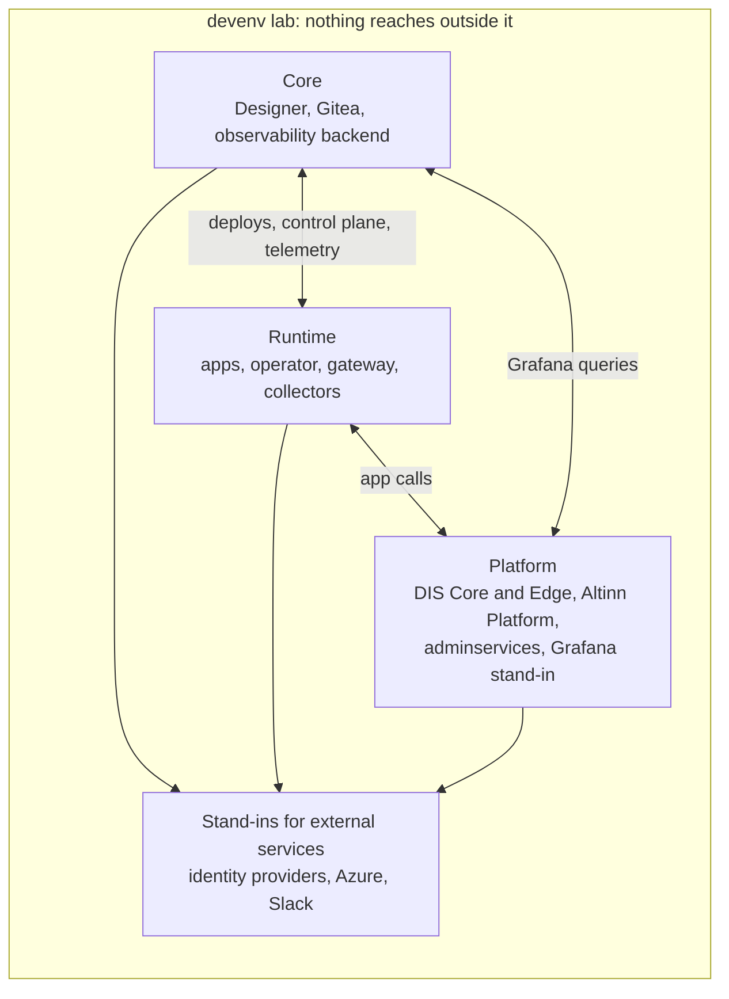

# devenv grows into a lab that reproduces the whole product

- Status: Proposed
- Deciders: Team
- Date: 02.11.2026

## Result

A4: devenv becomes the lab where we develop and test Altinn Studio. It reproduces Core, runtime and platform as separate
areas that follow production's boundaries. Each area deploys from production's manifests with thin local overlays and
lists how it differs from production. A topology chooses the areas, their profiles and whether they share a cluster.
The lab reaches nothing outside itself, and it gives people and agents a small set of operations: start a topology,
report its state, inject a fault, observe, and reset.

## Problem context

[devenv](../../src/Runtime/devenv/README.md) starts a kind cluster set up like a runtime cluster. The e2e tests of the
gateway, the operator and pdf3 run on it. With monitoring, it also runs the observability pipeline from
`infra/observability`, through [local overlays](../../infra/observability/local/README.md) of production's manifests.

We now use it for more than e2e tests:

- As a lab for monitoring and alerting. A real fault, such as a storage copy that refuses writes, should produce the
  signal an alert rule watches, and the rule should fire and notify. A unit test of a rule's query assumes that the
  signal exists. Only a real failure shows that it does, that it has the labels the rule expects, and that it does not
  simply go missing.
- In the future, as a target for security testing, such as pentests.

Agents do much of this work, as they do most of our development. People use the lab too.

Failures that matter often cross the boundaries between our [environments](../infrastructure/environments.md): Designer
deploys to a runtime cluster, an app calls Storage in the platform cluster, and traffic to pdf3 goes through DIS Edge to
DIS Core. devenv reproduces one runtime cluster. Components from other clusters run inside it, as pdf3 does, or are
missing. A lab limited to the runtime cluster cannot reproduce those failures, and a security test of one cluster
misses the boundaries an attacker would cross.

studioctl and localtest are Altinn Studio's interfaces for local app development, and localtest also runs Altinn
Platform services. App developers use them, so their experience decides the design. devenv serves the people and agents
who develop Altinn Studio, so fidelity and control decide its design. They can share code, but neither constrains the
other.

## Decision drivers

- B1: We can reproduce failures in and between Core, runtime and platform, and see whether they produce the signals,
  alerts and notifications we rely on.
- B2: Results hold in production. The lab runs production's manifests and images, and lists every way it differs.
- B3: Anyone, person or agent, can break things and attack the lab without affecting shared environments, other people
  or real services.
- B4: The lab starts from scratch the same way every time, on a developer's machine and in CI, and returns to a known
  state after a fault.
- B5: Tests that need only one area stay fast enough to run in CI.
- B6: Nice to have: little to maintain when production's manifests change, including manifests other teams own.

## Alternatives considered

- A1: Keep devenv a runtime cluster for e2e tests. Test failures, alerts and security in the shared dev and test
  environments.
- A2: Build the lab on localtest.
- A3: Run every component in one cluster, without the boundaries between production's clusters.
- A4: Separate areas that follow production's boundaries, deployed from production's manifests, combined into
  topologies.

## Pros and cons

### A1: Runtime cluster only, and the shared environments for the rest

- Good, because the shared environments are real, including the Azure services and the boundaries between clusters
  (B1, B2).
- Good, because devenv stays as it is (B6).
- Bad, because breaking or attacking a shared environment disturbs other teams and service owners, and agents cannot
  be let loose on it (B3).
- Bad, because we cannot inject and undo a fault on demand, and the environments drift between runs (B4).

### A2: The lab on localtest

- Good, because localtest already runs Altinn Platform services, and one tool would cover both.
- Bad, because localtest runs containers, not Kubernetes, so production's manifests, operators, NetworkPolicies and
  Flux do not apply (B2).
- Bad, because the lab's needs, such as fault injection and full production profiles, would make localtest heavier and
  harder to use for app developers.

### A3: One cluster with every component

- Good, because it is the smallest step from today's fixture and uses the least memory (B5).
- Bad, because calls between clusters become calls inside one cluster, so the lab cannot reproduce failures and attacks
  at those boundaries (B1, B3).
- Bad, because the overlays must merge configuration that production keeps apart, so the differences from production
  grow (B2, B6).

### A4: Areas that follow production's boundaries

- Good, because the lab can reproduce failures and attacks between areas when a test needs separate clusters (B1, B3).
- Good, because each area deploys from production's manifests, and its list of differences shows when a result might
  not hold in production (B2).
- Good, because a test starts only the areas and profiles it needs (B5).
- Good, because nothing is shared, so a fault or an attack affects only that lab (B3).
- Bad, because separate clusters need more memory and time to start than one.
- Bad, because the platform area depends on manifests and artifacts that other teams own and publish (B6).

## Draft of technical design

### Areas

- Each component runs in the area that runs it in production. Core is the Studio clusters, runtime is the runtime
  clusters, and platform is DIS Core, DIS Edge, the platform cluster and adminservices. The
  [environments](../infrastructure/environments.md) doc describes each of them.
- An area deploys from production's manifests the way production deploys them, with local overlays only where the lab
  must differ. The observability overlays already follow this rule.
- For manifests other teams own, an area uses what they publish, such as images and OCI artifacts, rather than a copy.
- Each area lists every way it differs from production. A stand-in for an external service, such as an identity
  provider or the shared Grafana, is one of those differences.
- Each area has a light profile, the default for CI, and a full profile in production's shape for the lab and for
  security testing.

### Topologies

- A topology names the areas, their profiles, and whether they share one kind cluster or each get their own. One
  cluster is cheaper. Separate clusters are for tests of the boundaries.
- A topology states the dependencies between its areas, so devenv starts them in order and checks each boundary.
- We add an area when a concrete failure or test needs it, starting with the boundary that failure crosses.

### Operations

People and agents use the lab through a few operations with machine-readable output:

- Start a topology, and report the state of each area.
- Inject a fault, such as scaling a workload to zero, denying traffic between two components, or a dependency that
  refuses requests. devenv records what it changed and undoes it.
- Observe through the lab's metrics, logs, traces, Grafana and the notifications it received.
- Reset to the state the topology started in.

Fixed scenarios built on these operations stay with the service or area they test. Only those worth running regularly
run in CI.

### Alerting

The lab checks that a failure produces the signal a rule watches, and runs the full chain from failure to notification
for new rules and for the cases only Grafana decides, such as missing data. Tests of a rule's query logic do not need
the lab. They use input series shaped like the ones the lab produced.
