<div class="kicker">Altinn Studio</div>

# Harness engineering

<div class="text-2xl muted mt-2">Making the work of coding agents something we can trust</div>

<div class="accent-bar mt-8"><span /><span /><span /><span /></div>

<div class="absolute bottom-10 left-14 text-sm muted">
Altinn Studio · Digdir
</div>

---

<div class="kicker">Agenda</div>

<div class="grid grid-cols-[1.3fr_1fr] gap-10 mt-8">

<div class="flex flex-col gap-2">
  <div class="box"><div class="flex items-center gap-4"><span class="tag">1</span><span class="title">Why, and where we are going</span></div></div>
  <div class="box"><div class="flex items-center gap-4"><span class="tag">2</span><span class="title">Model, harness, interface and computer</span></div></div>
  <div class="box blue"><div class="flex items-center gap-4"><span class="tag blue">3</span><span class="title">What the agent knows</span></div></div>
  <div class="box green"><div class="flex items-center gap-4"><span class="tag green">4</span><span class="title">How it checks its work</span></div></div>
  <div class="box coral"><div class="flex items-center gap-4"><span class="tag coral">5</span><span class="title">Where it works</span></div></div>
  <div class="box amber"><div class="flex items-center gap-4"><span class="tag amber">6</span><span class="title">How we improve it</span></div></div>
  <div class="box"><div class="flex items-center gap-4"><span class="tag">7</span><span class="title">Demo, and where to start</span></div></div>
</div>

<div class="card self-start" style="border-color: var(--dd-green)">
  <div class="text-2xl mb-2">🚀</div>
  <h3>But first, some harness engineering</h3>
  <p>Two agents each get a real issue from our backlog, and fix it in a sandbox of their own on a desktop machine. We check on them at the end.</p>
</div>

</div>

<!--
The next slide has the two prompts. Copy each into its own agent in T3 Code.
-->

---
class: tight
---

<div class="kicker">Demo · start the agents</div>

# Two issues, two agents

<div class="grid grid-cols-2 gap-6 mt-3">

<div class="flex flex-col gap-2">
  <div class="flex items-center gap-2"><span class="tag blue whitespace-nowrap">agent 1</span><a href="https://github.com/Altinn/altinn-studio/issues/19953" target="_blank">#19953</a><span class="muted text-sm">a tiny number shown as 3 quadrillion</span></div>
  <div class="prompt">

```text
Reproduce and fix https://github.com/Altinn/altinn-studio/issues/19953, with ttd/martiontest as the test app. Have gpt-6.1-sol review the change in fast mode, then open a draft pull request with a recording of before and after.
```

  </div>
</div>

<div class="flex flex-col gap-2">
  <div class="flex items-center gap-2"><span class="tag amber whitespace-nowrap">agent 2</span><a href="https://github.com/Altinn/altinn-studio/issues/21584" target="_blank">#21584</a><span class="muted text-sm">image builds that send too much</span></div>
  <div class="prompt">

```text
Fix https://github.com/Altinn/altinn-studio/issues/21584 for the images that build from src/. Open a draft pull request with a table of build time and context size before and after.
```

  </div>
</div>

</div>

<div class="text-center text-lg mt-8">That is all they get.<br/><span class="muted">The rest is the harness: what they know, the checks they run and the computer they run them on.</span></div>

<!--
Copy each prompt into its own agent in T3 Code: hover over a prompt and click the copy button. Both agents open real draft pull requests.
-->

---

<div class="kicker">Where we are</div>

# More to deliver, with fewer people

<div class="grid grid-cols-4 gap-4 mt-8">
  <div class="card" v-click>
    <div class="text-3xl mb-3">🏁</div>
    <h3>Altinn 3 is done</h3>
    <p>The migration is finished. What it left behind is still ours to clean up.</p>
  </div>
  <div class="card" v-click>
    <div class="text-3xl mb-3">🧱</div>
    <h3>Lots of technical debt</h3>
    <p>Code, infrastructure and docs that need work, alongside everything new.</p>
  </div>
  <div class="card" v-click>
    <div class="text-3xl mb-3">🚪</div>
    <h3>People are leaving</h3>
    <p>Consultants with valuable knowledge are leaving, and what they know leaves with them.</p>
  </div>
  <div class="card" v-click>
    <div class="text-3xl mb-3">📦</div>
    <h3>Still lots to deliver</h3>
    <p>Service owners and the roadmap don't wait for us to catch up.</p>
  </div>
</div>

<div class="text-center text-xl mt-10" v-click>
We need <span class="c-sky font-semibold">more done per person</span>, without <span class="c-coral font-semibold">lowering quality</span>. <br/>
That is why we are going deep on AI-native engineering.
</div>

<div class="text-center muted text-sm mt-4" v-click>
"Coding agents now write much of our code, and they need the same knowledge about our systems as the people on the team." Altinn Studio's documentation ADR, October 2026
</div>

<!--
Knowledge leaving with people is also a harness problem. What lives in the repository, as docs, skills and checks, stays when people go, and agents and new colleagues read the same thing.
-->
---
class: tight
---

<div class="kicker">Where we are going</div>

# From a chat window to virtual engineers

<div class="grid grid-cols-[10rem_1fr] gap-x-4 gap-y-2 mt-3 items-center text-sm">
  <div></div>
  <div class="grid grid-cols-4 text-center">
    <span class="font-semibold">Chat</span><span class="font-semibold">Your laptop</span><span class="font-semibold">A personal sandbox</span><span class="font-semibold c-green">Virtual engineers</span>
  </div>

  <div><div class="title text-sm">Model</div><div class="sub">the task length it finishes half the time</div></div>
  <MetrLine />

  <div v-click class="title text-sm">Computer</div>
  <div v-after class="lane"><span class="tag">none</span><span class="tag">yours</span><span class="tag blue">a sandbox, your worktree</span><span class="tag green">its own, a fresh checkout</span></div>
  <div v-click class="title text-sm">Who checks the work</div>
  <div v-after class="lane"><span class="tag">you, all of it</span><span class="tag">you, every step</span><span class="tag blue">you, most of it</span><span class="tag green">the agent, with evidence</span></div>
  <div v-click class="title text-sm">What it knows</div>
  <div v-after class="lane"><span class="tag">your prompt</span><span class="tag">your own notes</span><span class="tag blue">an AGENTS.md</span><span class="tag green">docs, skills and checks</span></div>
  <div v-click class="title text-sm">Your job</div>
  <div v-after class="lane"><span class="tag">write the code</span><span class="tag">approve each step</span><span class="tag blue">review the work</span><span class="tag green">build the factory</span></div>
  <div v-click class="title text-sm c-coral">The tooling we build?</div>
  <div v-after class="lane question"><span class="tag">a chat app</span><span class="tag">harness settings</span><span class="tag coral">easy personal sandboxes</span><span class="tag coral">agents defined in the repo</span></div>
</div>

<div class="text-center text-lg mt-5" v-click>
Models like Opus 5.5 can already do the work on the right. <br/>
What holds us back is the <span class="c-sky font-semibold">harness</span>, and our <span class="c-green font-semibold">ambition</span>.
</div>


<!--
The model row is METR's time horizon: the length of task, in human working time, that a model finishes half the time. It has doubled about every four months since 2023. Opus 5.5 has no published horizon, since METR's tasks can't measure beyond about 16 hours, and Claude Mythos Preview already reached that in April 2026.

This is where we are going. Each lane moves with the others: a model that can work for hours is wasted without a computer to work on, checks it can run and knowledge it can find.

The last lane is an open question for us: should the tooling we build for Digdir fit the left or the right? This is the tension in designing agentctl. Some want a personal sandbox that is easy to start, with their own worktree mounted. That is close to the laptop stage: they still do much of the work, verify it and review it. Further along, the agent is a virtual engineer on its own computer. Then it makes sense to check its definition into the repository, where product owners, designers and developers all improve it. Our job moves from looking after one agent in our own worktree to building the factory.

The ask: raise your ambition one step to the right. The rest of the talk is what the right end takes, and the demo at the end shows it running.
-->

---

<div class="kicker">Terms</div>

# Model, harness, interface

<div class="grid grid-cols-3 gap-5 mt-6">
  <div class="card">
    <div class="tag mb-3">model</div>
    <h3>Generates text</h3>
    <p>Claude, GPT, Qwen. On its own it can only write. It cannot read a file or run a test.</p>
  </div>
  <div class="card" style="border-color: var(--dd-sky)">
    <div class="tag blue mb-3">harness</div>
    <h3>Lets the model act</h3>
    <p>Tools such as read, edit, bash and search, the loop that runs them and feeds back the results, and the instructions and skills it loads. Claude Code, Codex, Pi.</p>
  </div>
  <div class="card">
    <div class="tag mb-3">interface</div>
    <h3>Where people come in</h3>
    <p>A terminal, an editor or a desktop app. Claude Code ships one with its harness, but the two are separate.</p>
  </div>
</div>

<div class="grid grid-cols-[auto_1fr] gap-6 mt-8 items-center" v-click>
  <div class="text-4xl">🍳</div>
  <div>
    <div class="text-lg">The model is the <span class="c-sky font-semibold">chef</span>. The harness is the <span class="c-sky font-semibold">kitchen</span>, with its tools. A tool like T3 Code is the <span class="c-sky font-semibold">restaurant</span>, which lets you bring whichever kitchen you like.</div>
    <div class="muted text-sm mt-2">After Theo Browne, "What is a 'harness'?", October 2026</div>
  </div>
</div>

<!--
Most people say "Claude Code" and mean all three. Separating them is what lets us swap one without the others.
-->

---

<div class="kicker">Our addition</div>

# An agent also needs a computer

<div class="text-center text-3xl font-semibold mt-6">
  agent = <span class="c-coral">computer</span> + <span class="c-sky">model</span> + <span class="c-amber">harness</span>
</div>

<div class="grid grid-cols-2 gap-8 mt-8">

<div class="box coral flex flex-col gap-2" style="padding: 0.9rem">
  <div class="flex items-center justify-between"><span class="title">Your laptop</span><span class="tag coral">shared</span></div>
  <div class="box"><div class="title text-sm">Your credentials</div><div class="sub">tokens, SSH keys, cloud logins and the company network</div></div>
  <div class="box"><div class="title text-sm">Permission prompts</div><div class="sub">approve every command, or trust it with your machine</div></div>
  <div class="box"><div class="title text-sm">One at a time</div><div class="sub">one set of ports, one Docker, one localtest</div></div>
</div>

<div class="box green flex flex-col gap-2" style="padding: 0.9rem" v-click>
  <div class="flex items-center justify-between"><span class="title">Its own computer</span><span class="tag green">agentctl sandbox</span></div>
  <div class="box"><div class="title text-sm">No real secrets inside</div><div class="sub">the host adds them only in requests to their allowed hosts</div></div>
  <div class="box"><div class="title text-sm">Root and no prompts</div><div class="sub">the blast radius is one virtual machine</div></div>
  <div class="box"><div class="title text-sm">As many as you can review</div><div class="sub">each with its own checkout, cluster and browser</div></div>
</div>

</div>

<div class="text-center text-lg mt-6" v-click>
We stopped sharing our computers with agents for <span class="c-coral font-semibold">security</span>, and it made them <span class="c-green font-semibold">more productive</span>.
</div>

<!--
The earlier decks in this folder cover the sandbox and its security in depth. Here it matters as part of the harness: what the agent can run decides what it can check.
-->

---
layout: center
---

<div class="kicker text-center">Definition</div>

<div class="big-quote text-center max-w-4xl">
Harness engineering is designing <br/>
<span class="c-sky">everything around the model</span>, <br/>
so that we can <span class="c-green">trust what comes out</span>.
</div>

<div class="grid grid-cols-4 gap-4 mt-10 max-w-5xl mx-auto">
  <div class="box blue"><div class="title">What it knows</div><div class="sub">docs, instructions, skills</div></div>
  <div class="box green"><div class="title">How it checks its work</div><div class="sub">tests, checks, running it for real</div></div>
  <div class="box coral"><div class="title">Where it works</div><div class="sub">its computer and its tools</div></div>
  <div class="box amber"><div class="title">How we improve it</div><div class="sub">every mistake fixes the harness</div></div>
</div>

<div class="text-center muted text-sm mt-8">
The term comes from OpenAI and Thoughtworks, early 2026: engineers design the environment and the feedback loops, and agents write the code.
</div>

---
class: tight
---

<div class="kicker">What it knows</div>

# Instructions that nobody reviewed

<div class="grid grid-cols-[1.3fr_1fr] gap-8 mt-2 items-center">

<div>
  <div class="text-sm muted mb-1">Lines in all <code>AGENTS.md</code> files in altinn-studio, 2026</div>
  <AgentsMdChart />
  <div class="grid grid-cols-2 gap-3 mt-2">
    <div class="box"><span class="text-xl font-bold">39 → 10</span> <span class="sub">AGENTS.md files</span></div>
    <div class="box"><span class="text-xl font-bold">2,864 → 72</span> <span class="sub">lines</span></div>
  </div>
</div>

<div class="flex flex-col gap-3">
  <div class="card" v-click>
    <h3>Generated, not reviewed</h3>
    <p>Agents wrote much of it as they worked, and people rarely read it, so it drifted from the code and the READMEs.</p>
  </div>
  <div class="card" v-click>
    <h3>Written for older models</h3>
    <p>Much of it worked around what early 2026 models got wrong, or described code that today's models read for themselves.</p>
  </div>
  <div class="card" v-click style="border-color: var(--dd-sky)">
    <h3>Not really about agents</h3>
    <p>Most of it was good documentation for anyone. It moved into READMEs and docs/, where people read and review it too.</p>
  </div>
</div>

</div>

<!--
The drop on 27 October is one pull request, [altinn-studio#21512](https://github.com/Altinn/altinn-studio/pull/21512), which moved the facts into READMEs and docs/.
-->

---

<div class="kicker">What it knows</div>

# Write for people, and agents read it too

<div class="grid grid-cols-[1fr_1.1fr] gap-8 mt-4">

<div class="flex flex-col gap-3">
  <div class="box blue"><div class="flex items-center justify-between"><span class="title">README, docs/, CONTRIBUTING</span><span class="tag blue">people and agents</span></div><div class="sub">what a component is for, how we work, why we decided</div></div>
  <div class="box amber"><div class="flex items-center justify-between"><span class="title">AGENTS.md</span><span class="tag amber">agents, every task</span></div><div class="sub">only what is specific to agents, in a few lines</div></div>
  <div class="box green"><div class="flex items-center justify-between"><span class="title">Skills</span><span class="tag green">agents, some tasks</span></div><div class="sub">procedures loaded on demand: app development, changelog, PR evidence, plain Norwegian</div></div>
  <div class="box coral"><div class="flex items-center justify-between"><span class="title">Agent definition</span><span class="tag coral">one computer</span></div><div class="sub">how this agent works, and what's special about its computer</div></div>
</div>

<div class="flex flex-col gap-3 text-sm">
  <div class="card">
    <h3>Agent-specific, from our root AGENTS.md</h3>
    <p class="mt-1" style="color: var(--dd-text)">"What you learn about the product or how we work goes into the repository through a pull request, not into your harness's memory, so that the rest of the team can read and review it."</p>
  </div>
  <div class="card" v-click>
    <h3>Written for people first</h3>
    <p>What a person also needs goes in the docs everyone reads and reviews.</p>
  </div>
  <div class="card" v-click>
    <h3>Plain Markdown for any harness</h3>
    <p>No CLAUDE.md and no harness-specific imports. CI checks both.</p>
  </div>
</div>

</div>

---

<div class="kicker">How it checks its work</div>

# Verification is what lets trust grow

<div class="grid grid-cols-[1.2fr_1fr] gap-10 mt-4 items-center">

<div class="flex flex-col gap-2">
  <div class="box"><div class="flex items-center justify-between"><span class="title text-sm">Builds, formats, lints</span><span class="tag">seconds</span></div></div>
  <div class="box"><div class="flex items-center justify-between"><span class="title text-sm">Unit and integration tests</span><span class="tag">minutes</span></div></div>
  <div class="box"><div class="flex items-center justify-between"><span class="title text-sm">Repository checks: docs, spelling, changelog, PR title</span><span class="tag">CI</span></div></div>
  <div class="box green"><div class="flex items-center justify-between"><span class="title text-sm">Runs the system: Studio, localtest, kind</span><span class="tag green">own computer</span></div></div>
  <div class="box green"><div class="flex items-center justify-between"><span class="title text-sm">Looks at the result: browser, desktop, Cypress</span><span class="tag green">own computer</span></div></div>
  <div class="box blue"><div class="flex items-center justify-between"><span class="title text-sm">Shows a person: screenshots and recordings</span><span class="tag blue">review</span></div></div>
  <div class="box amber"><div class="flex items-center justify-between"><span class="title text-sm">Users try it, and their feedback sets the next step</span><span class="tag amber">we steer</span></div></div>
</div>

<div class="text-[0.95rem]">

<v-clicks>

- Every check an agent runs itself is one **you don't have to do**
- The further down the list, the closer it gets to **what users see**
- The bottom half needs **a full computer of its own**: containers, clusters, a browser and root
- On **our own laptops** we have to hold an agent back, and soon policy won't allow it there at all
- The last check is **the users**: we listen, and we decide where to go next
- So **quality rises together with productivity**

</v-clicks>

</div>

</div>

<!--
This is the core of the talk. Faster output without verification only moves the work to the reviewer.
-->

---

<div class="kicker">How it checks its work</div>

# Checks that say what to do next

<div class="grid grid-cols-[1.2fr_1fr] gap-8 mt-4">

<div class="flex flex-col gap-3">

```text
Documentation validation failed with 1 problem(s):

  - src/x/CLAUDE.md: CLAUDE.md is no longer used — put the
    guidance in src/x/AGENTS.md, which every agent reads
    directly

See docs/documentation.md.
```

<div class="text-sm muted">From <code>yarn docs:validate</code>, which CI runs on every pull request. An agent reads the failure and fixes it without asking. The agent image has the same tools as CI, so it runs the same checks before it pushes.</div>

</div>

<div class="flex flex-col gap-3">
  <div class="card" v-click style="border-color: var(--dd-sky)"><h3>Script what can be scripted</h3><p>What agents do often, or often get wrong, becomes a script or a CI check. Their attention and context go to the parts that need judgment.</p></div>
  <div class="card" v-click><h3>Cheap to build now</h3><p>An agent writes the check, and proves that it catches the problem, in minutes.</p></div>
  <div class="card" v-click><h3>Read by people and agents</h3><p>The same message tells a person and an agent what to fix.</p></div>
</div>

</div>

---

<div class="kicker">How it checks its work</div>

# Run it, look at it, show it

<div class="mt-8">
  <div class="grid grid-cols-5 gap-5">
    <div class="box relative text-center"><div class="title">Change code</div><div class="sub">&nbsp;</div><span class="absolute right-[-1.05rem] top-1/2 -translate-y-1/2 muted">→</span></div>
    <div class="box relative text-center"><div class="title">Build and test</div><div class="sub">&nbsp;</div><span class="absolute right-[-1.05rem] top-1/2 -translate-y-1/2 muted">→</span></div>
    <div class="box amber relative text-center"><div class="title">Run it for real</div><div class="sub">localtest · kind · Podman</div><span class="absolute right-[-1.05rem] top-1/2 -translate-y-1/2 muted">→</span></div>
    <div class="box amber relative text-center"><div class="title">Look at it</div><div class="sub">browser · desktop</div><span class="absolute right-[-1.05rem] top-1/2 -translate-y-1/2 muted">→</span></div>
    <div class="box green text-center"><div class="title">PR with evidence</div><div class="sub">for the reviewer</div></div>
  </div>
  <div class="grid grid-cols-5 gap-5">
    <div class="col-span-4">
      <div class="relative h-8 rounded-b-xl border-2 border-t-0 border-dashed" style="border-color: var(--dd-muted); margin: 0 calc((100% - 3.75rem) / 8)">
        <span class="absolute left-[-0.45rem] top-[-0.7rem] text-xs muted">▲</span>
        <span class="absolute left-1/2 -translate-x-1/2 bottom-[-0.7rem] px-2 text-xs muted" style="background: var(--dd-bg)">not right yet: back to the code</span>
      </div>
    </div>
  </div>
</div>

<div class="grid grid-cols-3 gap-4 mt-10">
  <div class="card" v-click><h3>The whole stack</h3><p><code>studioctl</code> runs Studio, localtest and apps. kind runs the cluster parts.</p></div>
  <div class="card" v-click><h3>A desktop it can drive</h3><p>Chromium, Playwright and a computer-use skill, so it sees what a user would see.</p></div>
  <div class="card" v-click><h3>Evidence for the reviewer</h3><p>The pr-evidence skill attaches screenshots and recordings from the tested revision, so you review the result and not only the diff.</p></div>
</div>

---

<div class="kicker">Where it works</div>

# The computer is part of the harness

<div class="grid grid-cols-[1fr_1.1fr] gap-8 mt-4">

<div class="card font-mono text-xs leading-6" style="padding: 1rem 1.2rem">
  <div class="muted">altinn-studio/agents/</div>
  <div>├─ <span class="c-sky">Dockerfile</span> <span class="muted">· every toolchain the repo needs</span></div>
  <div>├─ <span class="c-sky">smoke.sh</span> <span class="muted">· proves it, in CI</span></div>
  <div>├─ <span class="c-amber">instructions.md</span> <span class="muted">· role and habits</span></div>
  <div>├─ <span class="c-green">_skills/</span> <span class="muted">· one home for skills</span></div>
  <div>├─ minimal/</div>
  <div>└─ desktop/</div>
  <div>&nbsp;&nbsp;&nbsp;├─ <span class="c-coral">agent.yaml</span> <span class="muted">· resources, secrets, network</span></div>
  <div>&nbsp;&nbsp;&nbsp;├─ <span class="c-coral">agent.nested.yaml</span></div>
  <div>&nbsp;&nbsp;&nbsp;└─ <span class="c-amber">environment.md</span> <span class="muted">· what's special about it</span></div>
</div>

<div class="flex flex-col gap-3">
  <div class="card" v-click><h3>Ready to verify</h3><p>.NET 8, 10 and 11, Go, Rust, Node, Python, Podman, kind, Chromium and studioctl, logged in to Studio at boot.</p></div>
  <div class="card" v-click><h3>Checks its own computer</h3><p>An agent that changes the image boots it in a nested agent and builds and tests the repository there, before anyone else gets it, as in <a href="https://github.com/Altinn/altinn-studio/pull/21492" target="_blank">#21492</a>.</p></div>
  <div class="card" v-click><h3>Reviewed like code</h3><p>A better toolbox or skill reaches everyone's agents on their next apply.</p></div>
</div>

</div>

<!--
Small details count: the image runs on Norwegian time, so the dates agents write in commits and changelogs match what reviewers expect.
-->

---

<div class="kicker">Where it works</div>

# Swap any layer, keep what's ours

<div class="grid grid-cols-4 gap-3 mt-4">
  <div class="box flex flex-col"><div class="title text-sm mb-2">Interface</div><div class="flex flex-wrap gap-1 flex-1 content-start"><span class="tag">TUI</span><span class="tag">T3 Code</span><span class="tag">VS Code</span><span class="tag">desktop apps</span></div><div class="text-xs c-sky mt-2" v-click="1">any client, over SSH</div></div>
  <div class="box flex flex-col"><div class="title text-sm mb-2">Harness</div><div class="flex flex-wrap gap-1 flex-1 content-start"><span class="tag">Claude Code</span><span class="tag">Codex</span><span class="tag">Pi</span></div><div class="text-xs c-sky mt-2" v-click="1">an adapter for each</div></div>
  <div class="box flex flex-col"><div class="title text-sm mb-2">Model</div><div class="flex flex-wrap gap-1 flex-1 content-start"><span class="tag">Claude</span><span class="tag">GPT</span><span class="tag">open models on aivar</span></div><div class="text-xs c-sky mt-2" v-click="1">one line in the manifest</div></div>
  <div class="box flex flex-col"><div class="title text-sm mb-2">Computer</div><div class="flex flex-wrap gap-1 flex-1 content-start"><span class="tag">OCI images</span><span class="tag">Linux, macOS, Windows</span><span class="tag">libkrun microVMs</span></div><div class="text-xs c-sky mt-2" v-click="1">any image, in a microVM</div></div>
</div>

<div class="grid grid-cols-4 gap-3 text-center text-xs c-sky my-1" v-click="1"><span>▲</span><span>▲</span><span>▲</span><span>▲</span></div>

<div class="box blue text-center" v-click="1" style="padding: 0.7rem 1rem">
  <div class="title">agentctl and the Sandbox SDK</div>
  <div class="sub mt-1">make each layer above swappable · built centrally, for all of Digdir</div>
</div>

<div class="box amber mt-4" v-click="2" style="padding: 0.8rem 1rem">
  <div class="text-center mb-3"><div class="title">Altinn Studio</div><div class="sub mt-1">specific to the product and its domain · built by the team</div></div>
  <div class="grid grid-cols-3 gap-3">
    <div class="box"><div class="title text-sm">What it knows</div><div class="sub">docs, AGENTS.md and skills</div></div>
    <div class="box"><div class="title text-sm">How it checks its work</div><div class="sub">tests, CI checks and scripts</div></div>
    <div class="box"><div class="title text-sm">Agent definitions</div><div class="sub">the image, manifest and instructions</div></div>
  </div>
</div>

<!--
The top row is in large part swappable because of agentctl, the Sandbox SDK and the choices made there: adapters for what we don't own, plain Markdown and the open skills format, and any OCI image as the computer. A better model next month is a one-line change, and so is another image. That part is developed once, for everyone in Digdir. What sits at the bottom is ours as a product team, and every team writes its own.
-->

---

<div class="kicker">How we improve it</div>

# Fix the harness, not the output

```mermaid {scale: 0.6}
flowchart TB
  A["Agent gets something wrong"] --> R["You notice it in review"]
  R --> F["Change the harness<br/><small>docs · skill · check · image</small>"]
  F --> P["Pull request"]
  P --> E["Every agent, next apply"]
  E -.-> A
  style F stroke:#e5aa20
  style E stroke:#3fb27f,fill:#12301f
```

<div class="grid grid-cols-[1fr_1.25fr] gap-8 mt-4 items-center">



<div class="flex flex-col gap-2 text-sm">
  <div class="box"><span class="title text-xs">Don't add AI attribution to commits</span> <span class="sub">· <a href="https://github.com/Altinn/altinn-studio/pull/20457" target="_blank">#20457</a></span></div>
  <div class="box"><span class="title text-xs">Run on Norwegian time</span> <span class="sub">· <a href="https://github.com/Altinn/altinn-studio/pull/20465" target="_blank">#20465</a></span></div>
  <div class="box"><span class="title text-xs">Make Chromium trust the mediated network</span> <span class="sub">· <a href="https://github.com/Altinn/altinn-studio/pull/20537" target="_blank">#20537</a></span></div>
  <div class="box"><span class="title text-xs">Write clickable links and resolvable file paths</span> <span class="sub">· <a href="https://github.com/Altinn/altinn-studio/pull/20990" target="_blank">#20990</a></span></div>
  <div class="box"><span class="title text-xs">Record local development gotchas</span> <span class="sub">· <a href="https://github.com/Altinn/altinn-studio/pull/21056" target="_blank">#21056</a></span></div>
  <div class="box"><span class="title text-xs">A skill for dependency alerts</span> <span class="sub">· <a href="https://github.com/Altinn/altinn-studio/pull/21234" target="_blank">#21234</a></span></div>
  <div class="text-xs muted mt-1">77 changes to <code>agents/</code> since it was added on 26 August</div>
</div>

</div>

---

<div class="kicker">How we improve it · nested agents</div>

# Test a change in an agent inside the agent

<div class="grid grid-cols-[1fr_auto_15rem] gap-5 mt-4 items-center">

<div class="box" style="padding: 0.8rem">
  <div class="flex items-center justify-between mb-2"><span class="title">💻 Desktop machine</span><span class="tag">host</span></div>
  <div class="box amber" style="padding: 0.8rem">
    <div class="flex items-center justify-between mb-2"><span class="title">🤖 Agent</span><span class="tag amber">sandbox VM</span></div>
    <div class="box mb-3"><div class="title text-sm">Changes the definition, then gives both nested agents the same task</div><div class="sub">instructions, a skill, the image, or the model</div></div>
    <div class="grid grid-cols-2 gap-3">
      <div class="box blue" style="padding: 0.7rem; border-width: 2px">
        <div class="flex items-center justify-between mb-1"><span class="title">🤖 Nested agent</span><span class="tag blue">VM in a VM</span></div>
        <div class="text-sm" style="color: var(--dd-text)">as on <code>main</code></div>
        <div class="sub mt-1">does the task and checks its work</div>
      </div>
      <div class="box green" style="padding: 0.7rem; border-width: 2px">
        <div class="flex items-center justify-between mb-1"><span class="title">🤖 Nested agent</span><span class="tag green">VM in a VM</span></div>
        <div class="text-sm" style="color: var(--dd-text)">with the change</div>
        <div class="sub mt-1">does the task and checks its work</div>
      </div>
    </div>
  </div>
</div>

<div class="text-2xl c-sky">→</div>

<div class="flex flex-col gap-3">
  <div class="box green"><div class="title">A comparison</div><div class="sub">which checks passed, what each delivered, time and cost</div></div>
  <div class="box"><div class="title">A pull request</div><div class="sub">with the result as evidence</div></div>
</div>

</div>

<div class="grid grid-cols-2 gap-4 mt-4">
  <div class="card" v-click style="padding: 0.6rem 1rem"><h3>Done for real</h3><p><a href="https://github.com/Altinn/altinn-studio/pull/21492" target="_blank">#21492</a> added the toolchains the repository needs, and proved them in a nested agent built from the branch.</p></div>
  <div class="card" v-click style="padding: 0.6rem 1rem"><h3>Next: evaluations</h3><p>One task, two nested agents, one difference, to measure whether a change to the harness helps.</p></div>
</div>

---
layout: center
---

<div class="kicker text-center">Demo</div>

<h1 class="text-center">Back to the two agents</h1>

<div class="grid grid-cols-2 gap-6 mt-8 max-w-4xl mx-auto">
  <div class="card">
    <div class="tag blue mb-3">agent 1</div>
    <h3>The tiny number</h3>
    <p>How it reproduced <a href="https://github.com/Altinn/altinn-studio/issues/19953" target="_blank">#19953</a> in a browser, the fix and its test, the review, and the recording before and after.</p>
  </div>
  <div class="card">
    <div class="tag amber mb-3">agent 2</div>
    <h3>The image builds</h3>
    <p>What it changed for <a href="https://github.com/Altinn/altinn-studio/issues/21584" target="_blank">#21584</a>, and its table of build time and context size before and after.</p>
  </div>
</div>

<!--
Switch to T3 Code. If a run is not finished, show its desktop or its turns so far.
-->

---

<div class="kicker">Honest limits</div>

# What we haven't solved

<div class="grid grid-cols-2 gap-5 mt-6">
  <div class="card" v-click>
    <h3 class="c-coral">Review is the bottleneck</h3>
    <p>Agents open pull requests faster than people review them. Better evidence helps, but a person still decides.</p>
  </div>
  <div class="card" v-click>
    <h3 class="c-amber">Behaviour is hardest to check</h3>
    <p>Tests written by the same agent that wrote the code can share its mistakes. Running the real thing is our best answer so far.</p>
  </div>
  <div class="card" v-click>
    <h3 class="c-sky">We don't measure the harness yet</h3>
    <p>We only run evaluations by hand, now and then. We don't yet know which lines of a skill make a difference.</p>
  </div>
  <div class="card" v-click>
    <h3 class="c-green">It needs upkeep</h3>
    <p>Harness versions, images and docs change every week, and memory still piles up in personal harnesses.</p>
  </div>
</div>

---

<div class="kicker">Where to start</div>

# One step to the right

<div class="relative mt-6">
  <div class="absolute left-[12.5%] right-[12.5%] top-[2.1rem] h-[3px] rounded" style="background: linear-gradient(90deg, var(--dd-line), var(--dd-sky), var(--dd-green))"></div>
  <div class="grid grid-cols-4 gap-4 relative">
    <div class="text-center">
      <div class="font-semibold text-sm mb-2">Chat</div>
      <div class="w-4 h-4 rounded-full mx-auto" style="background: var(--dd-line)"></div>
    </div>
    <div class="text-center">
      <div class="font-semibold text-sm mb-2">Your laptop</div>
      <div class="w-4 h-4 rounded-full mx-auto" style="background: var(--dd-blue)"></div>
    </div>
    <div class="text-center">
      <div class="font-semibold text-sm mb-2">A personal sandbox</div>
      <div class="w-4 h-4 rounded-full mx-auto" style="background: var(--dd-sky)"></div>
    </div>
    <div class="text-center">
      <div class="font-semibold text-sm mb-2 c-green">Virtual engineers</div>
      <div class="w-4 h-4 rounded-full mx-auto" style="background: var(--dd-green)"></div>
    </div>
  </div>
  <div class="grid grid-cols-4 gap-4 mt-5">
    <div class="card" v-click>
      <div class="text-xs muted mb-2">If you are here, next →</div>
      <h3>Do real work</h3>
      <p>Use a harness such as Claude Code or Codex on real tasks in your own repository.</p>
    </div>
    <div class="card" v-click>
      <div class="text-xs muted mb-2">If you are here, next →</div>
      <h3>Give it a computer</h3>
      <p>Move the agent into a sandbox of its own, and stop approving every command.</p>
    </div>
    <div class="card" v-click>
      <div class="text-xs muted mb-2">If you are here, next →</div>
      <h3>Into the repository</h3>
      <p>Check in the agent definition, so it starts from a fresh checkout and runs its own checks.</p>
    </div>
    <div class="card" v-click style="border-color: var(--dd-green)">
      <div class="text-xs muted mb-2">If you are here, next →</div>
      <h3>Measure and improve</h3>
      <p>Evaluate the harness, and fix it through pull requests whenever an agent gets something wrong.</p>
    </div>
  </div>
</div>

<div class="text-center muted text-sm mt-8" v-click>
Let's discuss it in <span class="c-sky font-semibold">#team-agentic-sdlc</span>.
</div>

<!--
Ask people where they are on the line from earlier, and take one step to the right.

By role:
- Developers: give the agent checks it can run, and fix the harness when you review its work.
- Platform engineers: give agents computers: images, agentctl and KVM on our clusters.
- Product owners and designers: write the issues and docs agents read, and judge the evidence in their pull requests.
- Leaders: invest in the factory, not one more licence. It changes what the team works on.
-->
---
layout: end
---

<div class="kicker">Thanks</div>

# Questions?

<div class="accent-bar mx-auto mt-6"><span /><span /><span /><span /></div>

<div class="mt-10 text-xl">
Join us on Slack in <span class="c-sky font-semibold">#team-agentic-sdlc</span>
</div>
<div class="text-sm muted mt-1">where we develop agentctl and talk about how we work with agents</div>

<div class="mt-8 text-sm muted leading-7">
github.com/Altinn/altinn-studio · <code>agents/</code> · <code>docs/documentation.md</code><br/>
github.com/digdir/digdir-agents · <code>agentctl/README.md</code> · <code>agents/examples/</code>
</div>
