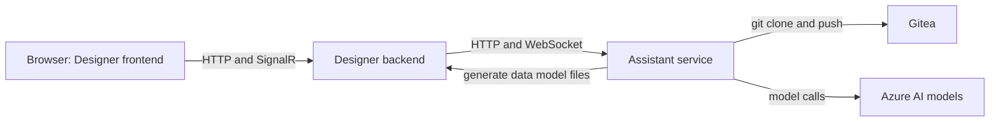
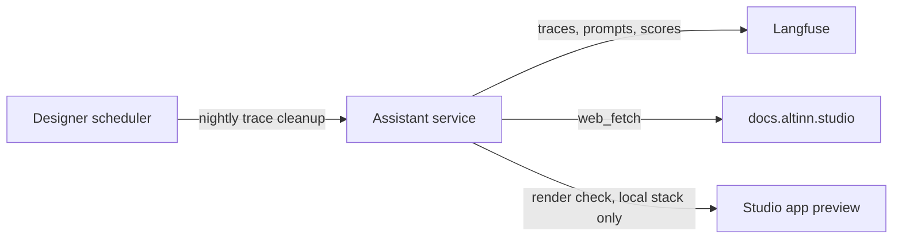
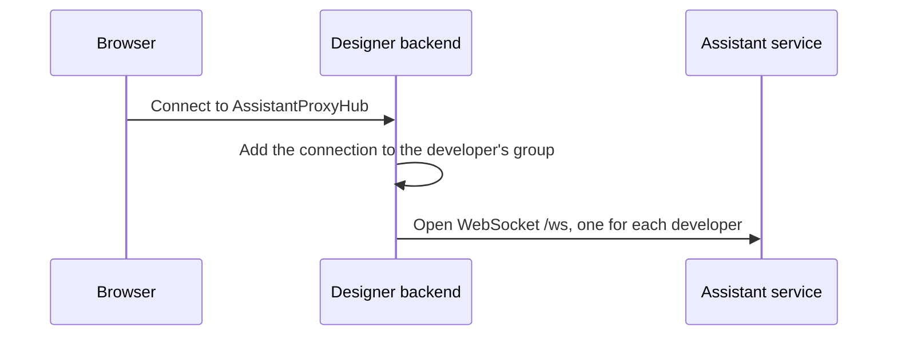
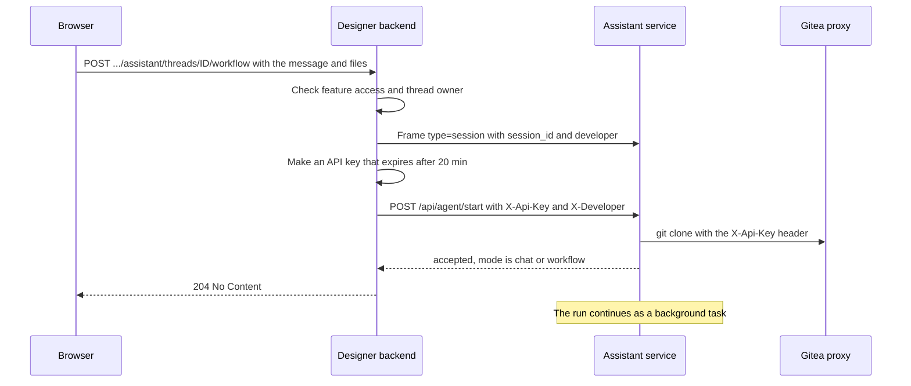
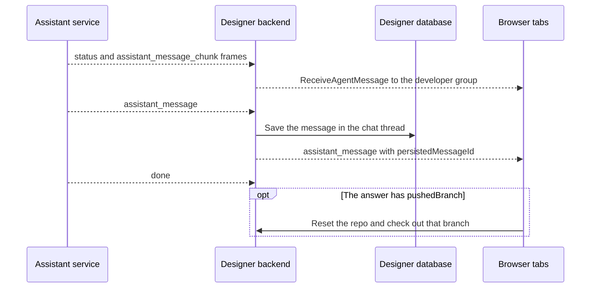
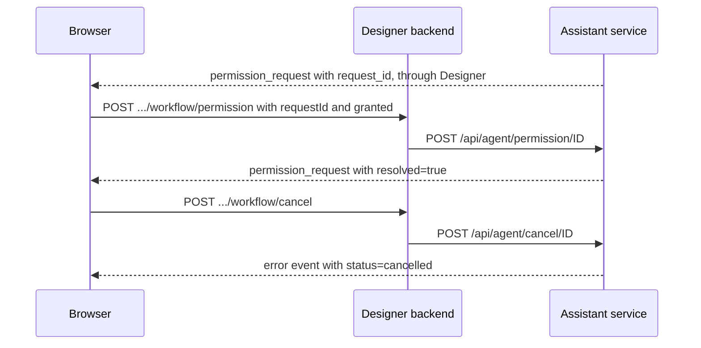
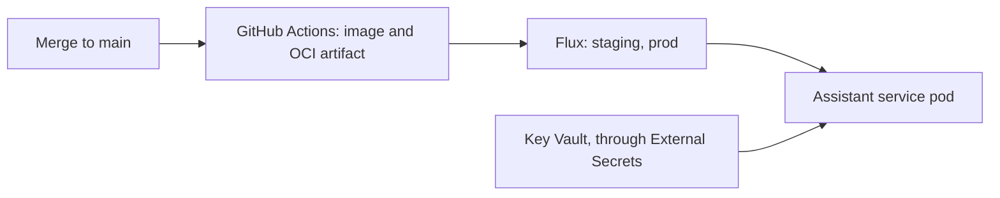
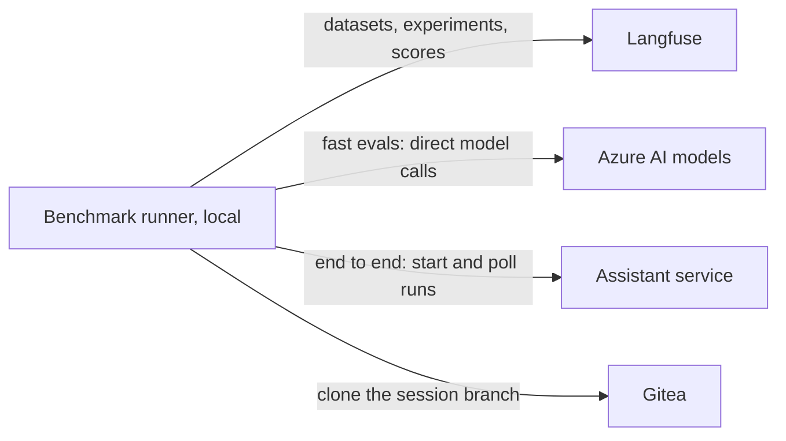
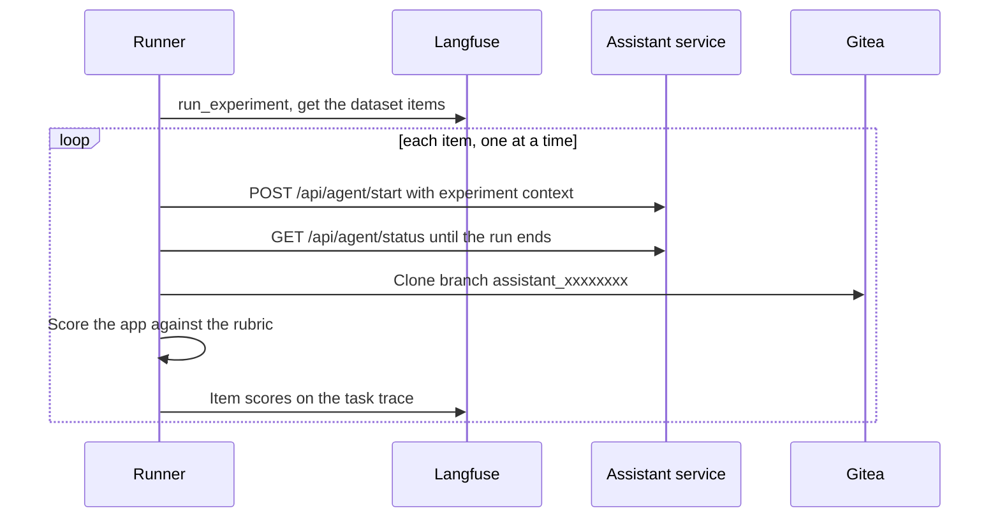
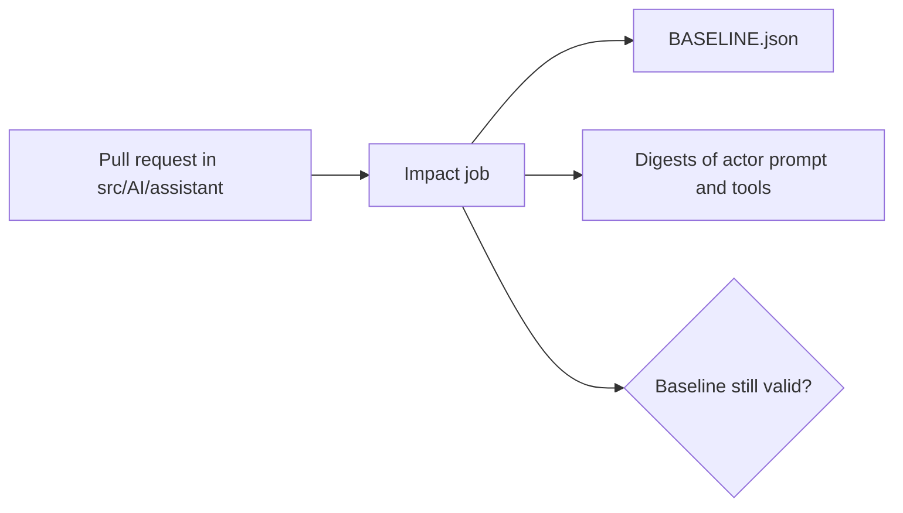

# Level 2: System context

_How is the service connected with other services?_

Designer code:

- `src/Designer/backend/src/Designer/Controllers/AssistantWorkflowController.cs`
- `src/Designer/backend/src/Designer/Hubs/Assistant/`
- `src/Designer/backend/src/Designer/Services/Implementation/Assistant/`
- `src/Designer/frontend/app-development/features/aiAssistant/`
- `src/Designer/frontend/libs/designer-assistant/`

The browser never calls the assistant service. The Designer backend is between them. The browser sends its commands to `AssistantWorkflowController` and gets events through SignalR (`AssistantProxyHub`). Designer sends commands to the assistant service and gets events through one WebSocket for each developer. In Kubernetes, the assistant service is the internal service `altinn-altinity-agents`. It listens on port 80 and sends traffic to the container on port 8071. A NetworkPolicy lets only the Designer pods connect to it.

_The main path. Gitea holds the app repositories. Azure OpenAI and Azure AI Foundry host the models._

_Support services. Langfuse is optional. Without it, the service records no traces and uses local prompt files._

## Connect

Each Designer replica opens one WebSocket to the assistant service for each developer. This socket stays open when the user reloads the page. Thus a run continues to send events after a page reload.

The assistant service sends events on a socket only after the socket gets a session frame. For each command from the browser, the replica that handles the command sends a session frame on its socket.

_Connection setup. The assistant service sends events by developer, not by tab._

## Start a run

Designer makes a short-lived API key for each run. The key expires after 20 minutes. The assistant service uses this key to clone and push through the Gitea proxy. It also uses the key to let the Designer API generate data model files. The service has no Gitea token of its own.

The browser sends the message and its attachments in one multipart request. Designer accepts eight file types, up to 20 MB for each file. The load balancer limits the whole request to 50 MB. Designer sends the files as base64 in the start request. It keeps no data between requests, so any replica can handle the request.

_The start request returns quickly. The real work happens after the response._

## Events come back

The assistant service pushes events on the WebSocket. Designer sends each event to the SignalR group of the developer, so all open tabs get it. Designer uses Redis as the SignalR backplane, so tabs on another replica also get the event. Designer also saves the final answer in its own database. This step makes sure that the answer is not lost when no tab is open.

Each Designer replica that has a WebSocket for the developer gets all the events, and each replica saves the answer. The database keeps one message for each event id, so the thread shows the answer one time. The browser does not save the answer. It gets the saved answer from Designer.

_Event flow from the assistant service to the user._

## Permission prompt and cancel

In chat mode, the first write tool call stops the loop and sends a `permission_request` event. The loop waits for the answer for a maximum of 300 seconds. No answer counts as "no". A cancel request sets a flag. The loop reads the flag at the start of each turn.

_Two user actions during a run. Designer checks that the developer can use the assistant and owns the thread. The assistant service checks that the caller owns the session._

## Deploy

A merge to main that changes `src/AI/assistant` goes to staging and production. The workflow `deploy-studio-ai-agents.yaml` builds the image, publishes the manifests as an OCI artifact and tags the artifact for each environment. Flux then does the rollout.

The pod gets five secrets from Key Vault: the Azure key and four Langfuse values. The model names are not in the manifest, so they come from the defaults in code.

_The deploy path. A change to the code goes to production in a few minutes._

## The benchmark workbench

The benchmark runner is a local command line tool. It does not run in production. Most evals call the models directly with the production prompts, without the assistant service. Only the end to end eval starts real runs on a local assistant service, through the same `/api/agent/start` route that Designer uses.

_What the runner connects to. Langfuse holds the dataset items and the results of each run._

An end to end item makes two traces in Langfuse. The runner trace has the scores. The agent trace has the model calls. The runner sends an `experiment` object in the start request, and the agent puts it on its trace. This connects the two traces.

_One end to end eval. The items run one at a time, because each run pushes to the same test repository._

GitHub Actions does not run the benchmark. The workflow `assistant-evals.yaml` only checks if a pull request makes the current baseline invalid. Scores change between runs, and a run costs money and needs secrets. For these reasons, the bench is a local command.

_The CI gate. It fails when a change moves what the bench measures and the pull request has no new `BASELINE.json`._
