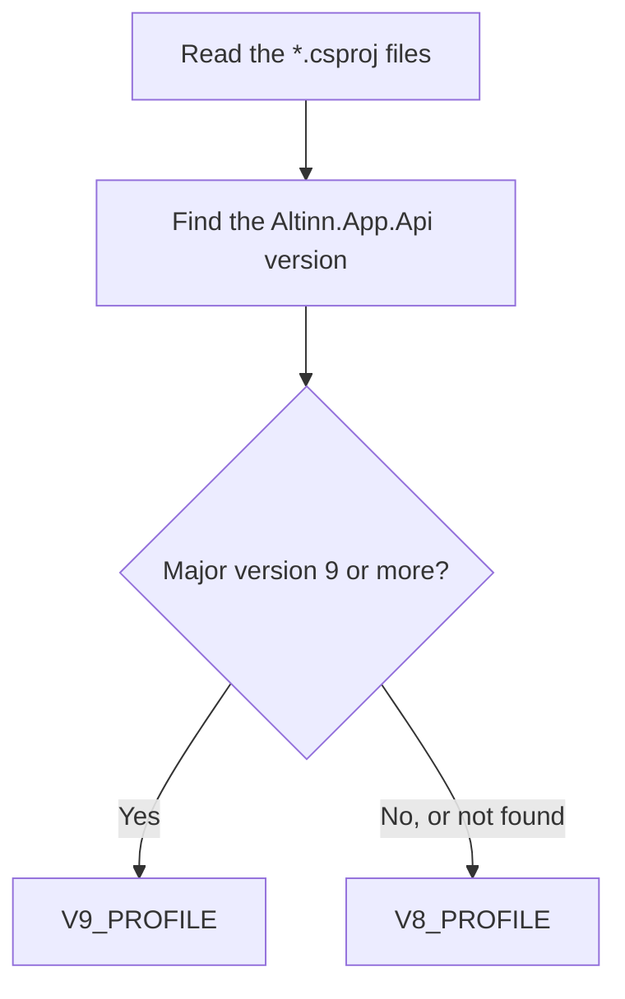

# Altinn domain library

Code: `src/AI/assistant/agents/altinn/app_version/`, `src/AI/assistant/agents/altinn/layout/`, `src/AI/assistant/agents/altinn/resources/`

This library is plain Python with no model calls. The tools call it in the same process. It does three jobs: it finds the app version, validates layouts against the official schema, and validates text resources. Designer generates the data model files, so that they are the same as the files that Studio writes (refer to [Tools](tools.md)).

_App version detection. It follows the same rule as Designer._

A version profile holds the prompt text, the layout schema location and the binding rules for one app version. The v8 layout schema comes from `altinncdn.no`. The v9 schema comes from `src/common/ts/layout-contract` in this repository. The service keeps a loaded schema in memory for 1 hour.
