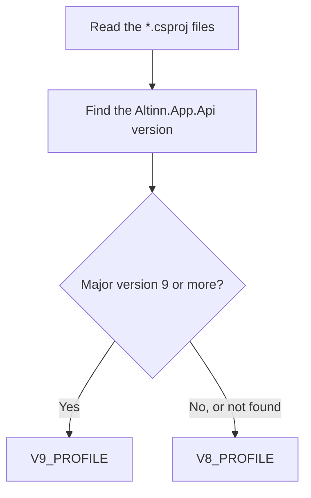

# Altinn domain library

Code: `src/AI/assistant/agents/altinn/app_version/`, `src/AI/assistant/agents/altinn/layout/`, `src/AI/assistant/agents/altinn/resources/`

This library is plain Python with no model calls. The tools call it in the same process. It does three jobs: it finds the app version, validates layouts against the official schema, and validates text resources.

_App version detection. It follows the same rule as Designer._

A version profile holds the prompt text, the locations of the layout and text resource schemas, and the binding rules for one app version. The v8 schemas come from the app frontend v4 toolkit on `altinncdn.no`. The v9 schemas come from `src/common/ts/layout-contract` in this repository. The service keeps a loaded schema in memory for 1 hour.

The unversioned copy of the text resource schema on `altinncdn.no`, under `/schemas/json/`, is out of date. It rejects variables that app frontend accepts, such as `defaultValue`.
