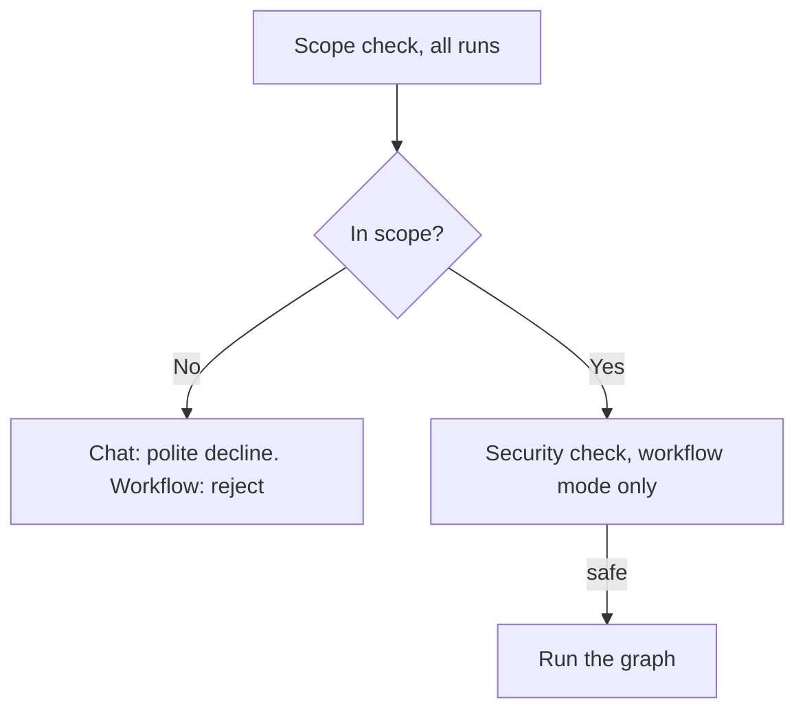
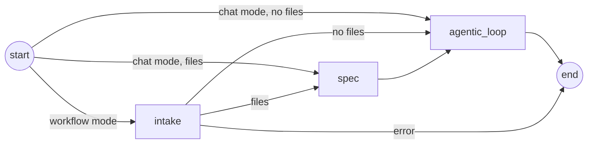
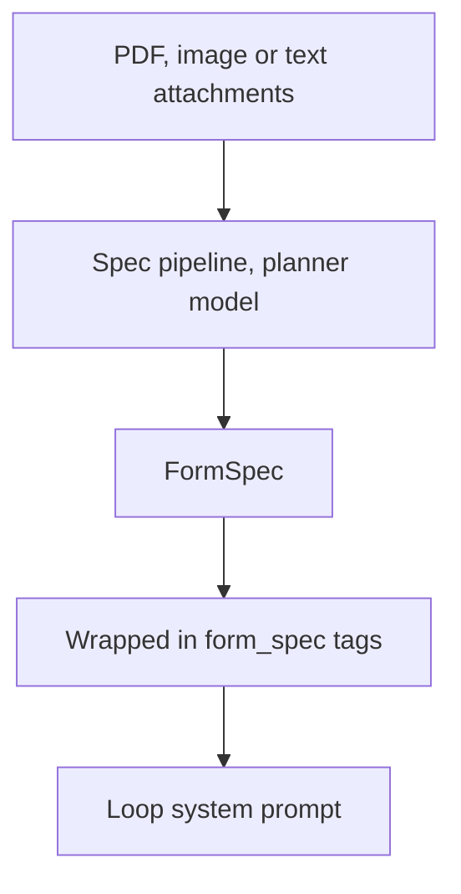
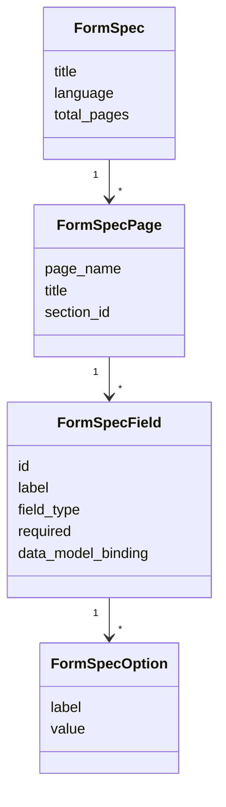
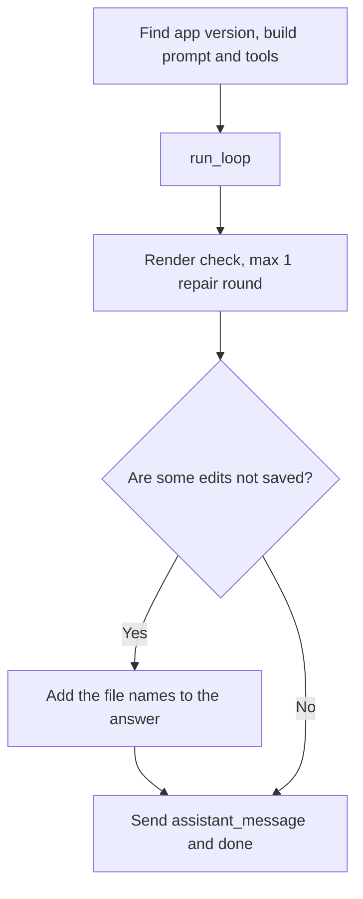
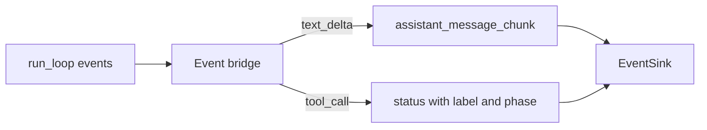

# Graph: gates, intake, spec and the loop node

Code: `src/AI/assistant/agents/graph/`, `src/AI/assistant/agents/workflows/`, `src/AI/assistant/agents/services/llm/scope_checker.py`, `src/AI/assistant/agents/services/llm/security_checker.py`

## Runner and gates

`run_once` in `src/AI/assistant/agents/graph/runner.py` opens one Langfuse root span for the run. Then it runs two gates before the graph. The scope check runs for all requests. The security check runs only in workflow mode. The scope check fails open: if the model call fails, the request continues. The security check fails closed: if it cannot run, a write request stops.

_The gates. An unsafe goal stops with `GoalRejected` and gets suggestions. An unclear goal goes to the loop. If the loop cannot tell what to change, its reply says what it needs._

_The LangGraph graph. Each node first checks if the user cancelled the session._

## Intake and spec

**Intake** runs only in workflow mode. One call to the planner model writes a short plan from the goal and the last 6 messages. Intake sends only the names of the attachments, not the content. The plan goes to the user as a `plan_proposed` event. No later step reads the plan.

**Spec** runs when the request has attachments. One call to the planner model reads the PDF, image or text file and returns a `FormSpec`. Text files go to the model as text, since Azure OpenAI takes only PDFs as files. This call can take 20 to 90 seconds. If spec fails, the run continues. The loop then gets an instruction to ask the user for the field list.

_From a document to the loop._

_The shape of a `FormSpec`, in `src/AI/assistant/agents/graph/state.py`._

## Agentic loop node

Code: `src/AI/assistant/agents/graph/nodes/agentic_loop_node.py`

This node prepares the loop and handles the result. It finds the app version (v8 or v9), builds the system prompt and registers the tools. In chat mode it connects the permission broker, so a write tool can ask the user.

Only the model saves edits, with `commit_session_branch`. The node does not save edits for the model. A save after the answer can fail when the answer says that the change is done. A save can also put work in the app that the answer calls not completed.

An edit is saved if it is on the remote session branch, because the user cannot see edits that stay in the container. The node asks git which edits are not saved. If some edits are not saved, the node adds a sentence with the file names to the answer. It also removes these files from `filesChanged`, and the run is not a success. A run that stopped before the end has only this sentence about its edits.

Edits that are not saved do not stay for the next turn. `RepoManager` resets the clone to the saved state when a turn starts, as [Git and repo](git-and-repo.md) describes.

After the loop, a session that can write has one safety step. If all edits are saved and a push in this turn succeeded, the node runs the render check. If a page does not render, the node gives the error to the model for one more loop run.

_The node steps. The render check runs only when the session can write._

An event bridge changes loop events into events for the user. It sends model text at most once each 100 ms. It changes tool calls into Norwegian status lines with a phase: reading, writing, verifying, committing or thinking.

_The event bridge. A `tool_use_id` lets the frontend replace a placeholder line in place._

The final message can also have these fields:

- `pushedBranch` is the session branch, if the assistant pushed a commit after the previous final message. A cancelled turn sends no final message, thus the next final message has its push. Designer resets the repo and checks out this branch, so that the preview shows the change. Without the field, Designer does not change the repo or the branch of the user.
- `attachmentInstructionFlagged` tells Designer to show the injection warning.
