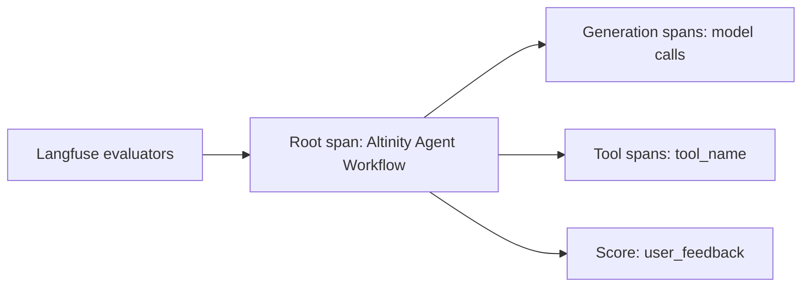

# Traces and usage

Code: `src/AI/assistant/shared/utils/langfuse_utils.py`, `src/AI/assistant/api/routes/traces.py`, `src/AI/assistant/api/routes/token_usage.py`, `src/AI/assistant/services/traces/`, `src/AI/assistant/services/token_usage/`, `src/AI/assistant/agents/prompts/llm-as-a-judge/`, `src/Designer/backend/src/Designer/Evaluators/CanUseAiAssistantEvaluator.cs`

Each run makes one Langfuse trace. The root span is "Altinity Agent Workflow". Model calls and tool calls are child spans. The output of the root span holds the summary, the changed files, the sources and the commit hash.

Four LLM-as-a-judge evaluators in Langfuse score this output: `intent_match`, `no_hallucination`, `faithful_summary` and `no_irrelevant_responses`. Their reviewed source is in `src/AI/assistant/agents/prompts/llm-as-a-judge/`. This is the online evaluation. The [benchmark](benchmarks.md) is the offline evaluation.

_The shape of one trace._

A thumbs up or down from the user becomes the score `user_feedback` on the trace. Only the developer who owns the trace can set it. A nightly Designer job calls `POST /api/traces/delete-expired`, which deletes traces older than the retention period (`LANGFUSE_TRACE_RETENTION_DAYS`). `GET /api/token-usage/daily` returns the tokens of the day before, for each service owner, in a billing format.

Designer records the model usage of each run on an organization, and sends it as `cost_org` in the start request. The trace gets it as `user_id`. In a repository of an organization, it is that organization. In the developer's own repository, it is the one organization with access to the assistant that the developer is a member of. If the developer is a member of more than one, it is `unattributed`.

## Telemetry in Grafana

Langfuse holds what the agent read and wrote. The assistant also exports traces, metrics and WARNING and ERROR logs
over OTLP to the cluster's collector, like Studio's other services, so its runs show in Studio's Grafana next to
Designer's requests. The deployment turns this on with `OTEL_EXPORTER_OTLP_ENDPOINT`.

- A run is a trace of its own, with a link to the `POST /api/agent/start` request that started it. Its span,
  `assistant.run`, carries the outcome, the models, the tokens, the tool calls and the time in each phase.
- Each model call is a `chat {model}` span with the GenAI semantic conventions' attributes, and records the metrics
  `gen_ai.client.operation.duration` and `gen_ai.client.token.usage`. `altinn.assistant.run.duration` counts runs
  by outcome.
- Request spans and run spans carry the developer's username as `enduser.id`, so a search finds what a developer
  did. Nothing in this telemetry holds prompts, model output or file content, and log records hold no usernames.
  They describe errors by their type, and exported exceptions keep their stack frames but not their messages.

Langfuse and the service each have a tracer provider, but OpenTelemetry has one current span. The
[isolation](../../shared/telemetry/isolation.py) makes each provider take parents only from its own spans. Langfuse's
traces then hold only Langfuse's observations, and the trace IDs the frontend sends feedback on stay Langfuse's.
