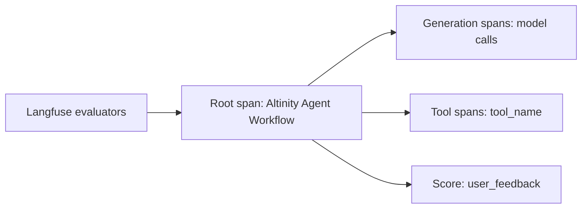

# Traces and usage

Code: `src/AI/assistant/shared/utils/langfuse_utils.py`, `src/AI/assistant/api/routes/traces.py`, `src/AI/assistant/api/routes/token_usage.py`, `src/AI/assistant/services/traces/`, `src/AI/assistant/services/token_usage/`, `src/AI/assistant/agents/prompts/llm-as-a-judge/`

Each run makes one Langfuse trace. The root span is "Altinity Agent Workflow". Model calls and tool calls are child spans. The output of the root span holds the summary, the changed files, the sources and the commit hash.

LLM-as-a-judge evaluators in Langfuse score this output, for example `intent_match` and `no_hallucination`. Their reviewed source is in `src/AI/assistant/agents/prompts/llm-as-a-judge/`. This is the online evaluation. The [benchmark](benchmarks.md) is the offline evaluation.

_The shape of one trace._

A thumbs up or down from the user becomes the score `user_feedback` on the trace. Only the developer who owns the trace can set it. A nightly Designer job calls `POST /api/traces/delete-expired`, which deletes traces older than the retention period (`LANGFUSE_TRACE_RETENTION_DAYS`). `GET /api/token-usage/daily` returns the tokens of the day before, for each service owner, in a billing format.

The trace gets `cost_org` from the start request as `user_id`, so the model usage of each run is recorded on an organization. [System context](../2-system-context.md) says how Designer selects it.

Langfuse filters and sums each observation on its own. So every observation of a run carries `user_id`, the session id and the trace name, not only the root span. In a benchmark run, every observation also carries the experiment item.

## Telemetry for operations

Code: `src/AI/assistant/shared/telemetry.py`

When `OTEL_EXPORTER_OTLP_ENDPOINT` is set, the service also sends telemetry over OTLP, as the [observability guide](../../../../../docs/observability.md) tells. Grafana shows it. This telemetry has no user text, model output, file content, usernames or exception messages. Langfuse keeps them.

- Each run has one span, `invoke_agent assistant`, in a new trace with a link to `POST /api/agent/start`. The span has the outcome, the tokens, the number of model calls, tool calls and turns, and the time in model calls and tools. The Langfuse trace of the run has the same trace ID.
- The metrics are `altinn.assistant.run.duration`, `altinn.assistant.run.active`, `altinn.assistant.tool.calls`, `gen_ai.client.operation.duration`, `gen_ai.client.token.usage` and the HTTP metrics of FastAPI.
- Only WARN and ERROR records go out. Write a constant message, and put values in `extra=`. The export removes `%s` values and the message of an exception.
