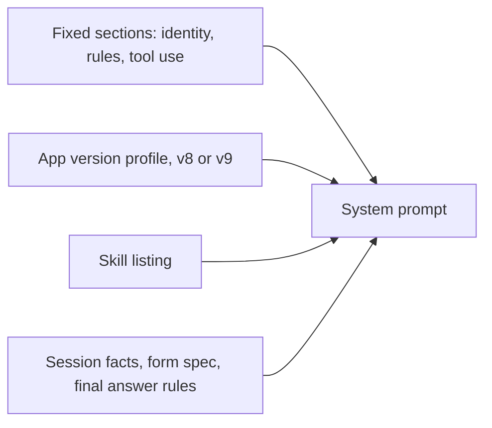
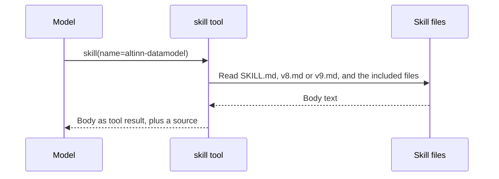
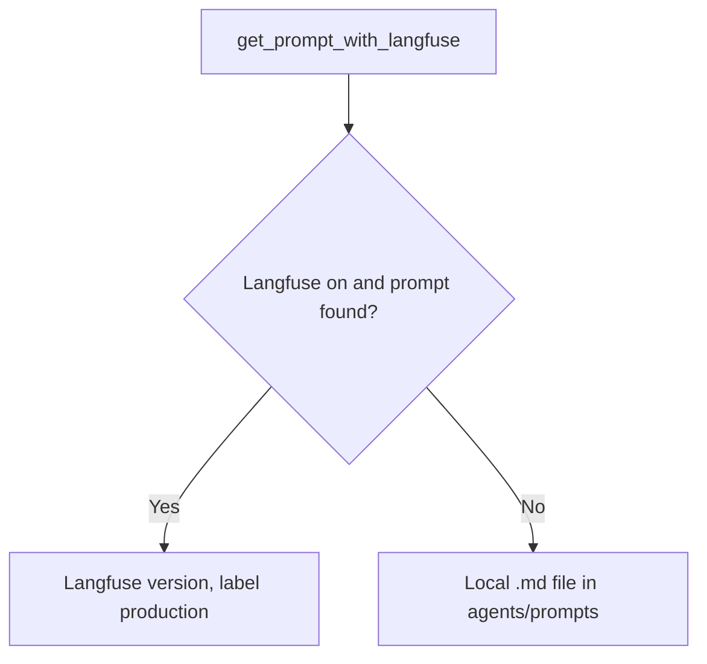

# Prompt and skills

Code: `src/AI/assistant/agents/core/context.py`, `src/AI/assistant/agents/core/skills.py`, `src/AI/assistant/agents/skills/`, `src/AI/assistant/agents/prompts/`, `src/AI/assistant/scripts/sync_prompts.py`

## The loop system prompt

The system prompt of the loop is built in code, from fixed sections and session facts. It explains the four parts of an Altinn app: layouts, data models, text resources and policy. It also lists rules that models often break.

_The parts of the loop system prompt. The final answer rules are different for chat mode and workflow mode._

## Skills

The assistant loads the skills that `SKILLS` in `src/AI/assistant/shared/config/base_config.py` names. They are the assistant's own, not the skills for coding agents in `agents/_skills/`.

Skills use progressive disclosure. The prompt has only the name and the description of each skill. The model calls the `skill` tool to get the body. A long body comes in parts, as [Tools](tools.md) describes.

_A skill load. The source becomes a link chip under the final answer._

To add a skill, make `src/AI/assistant/agents/skills/altinn-<name>/SKILL.md` and add the name to `SKILLS`. The loader takes the name from the folder and reads these fields, each on one line:

- `description`, which is necessary. The listing cuts it at 250 characters.
- `when_to_use`, which the listing adds after the description.
- `title` and `docs_url`, which the chat UI shows as the source chip of the answer. Use only a URL that you know is available.
- `include`, a list of files beside `SKILL.md`, with commas between them. The loader adds them to the body. This is the only way the model sees them, because `read_file` reads only the app repository.

A `v8.md` or `v9.md` file beside `SKILL.md` holds text for apps of that version. The loader adds it after the body, before the included files.

## Prompts for the gates, intake and spec

_Prompt loading. The CI workflow `assistant-prompts.yaml` publishes a changed prompt after the merge to main._

For names, publication, drift and retired prompts, refer to [agents/prompts/README.md](../../agents/prompts/README.md).
