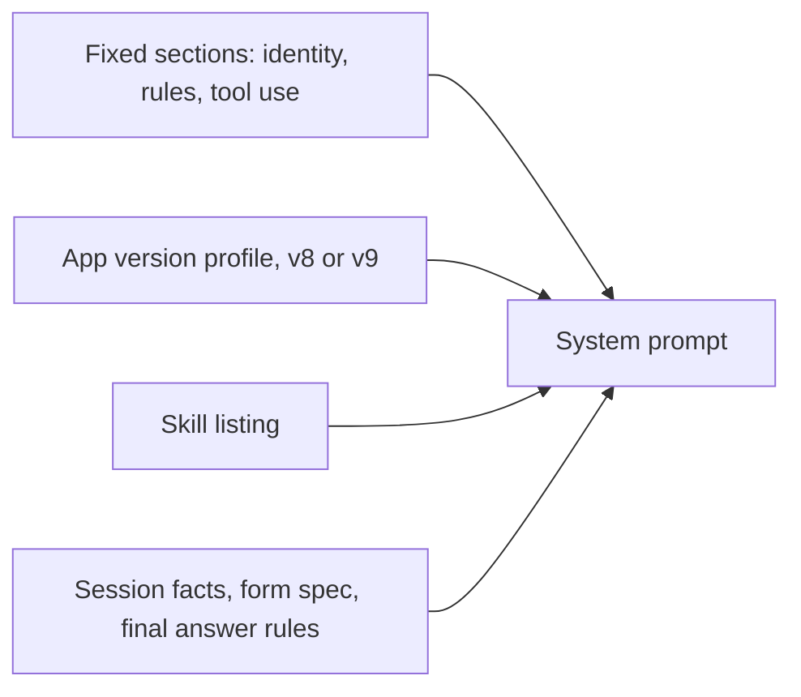
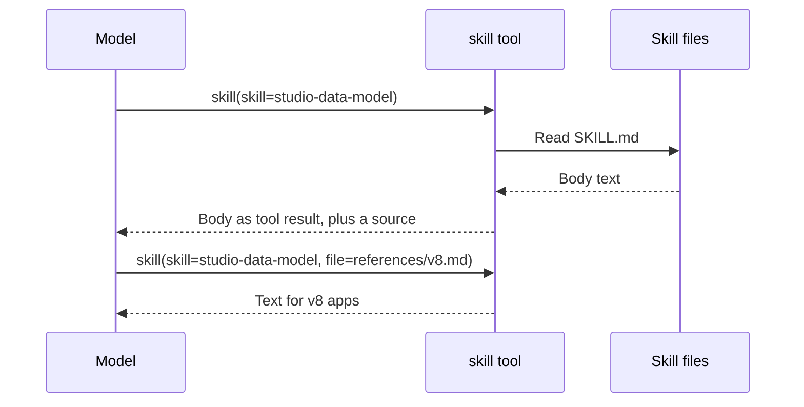
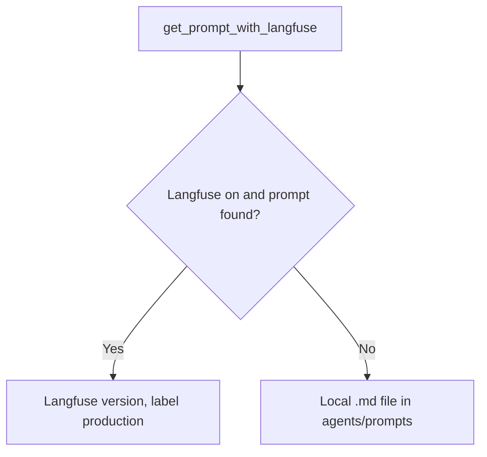

# Prompt and skills

Code: `src/AI/assistant/agents/core/context.py`, `src/AI/assistant/agents/core/skills.py`, `src/AI/assistant/agents/skills/`, `src/AI/assistant/agents/prompts/`, `src/AI/assistant/scripts/sync_prompts.py`

## The loop system prompt

The system prompt of the loop is built in code, from fixed sections and session facts. It explains the four parts of an Altinn app: layouts, data models, text resources and policy. It also lists rules that models often break.

_The parts of the loop system prompt. The final answer rules are different for chat mode and workflow mode._

## Skills

The assistant loads every skill in `src/AI/assistant/agents/skills/`. They are the assistant's own, not the skills for coding agents in `agents/_skills/`.

Skills use progressive disclosure. The prompt has only the name and the description of each skill. The model calls the `skill` tool to get the body, or a file that the body links to. A long body comes in parts, as [Tools](tools.md) describes.

_A skill load. The source becomes a link chip under the final answer._

To add a skill, make `src/AI/assistant/agents/skills/studio-<topic>/SKILL.md` in the [Agent Skills](https://agentskills.io/specification) format. The loader reads these fields:

- `name`, which is the same as the folder name.
- `description`, which is necessary. The listing cuts it at 250 characters.
- `metadata.studio-title` and `metadata.studio-docs-url`, which the chat UI shows as the source chip of the answer. `metadata.studio-docs-url-v9` is the URL for v9 apps, if the page is different. Use only a URL that you know is available.

Put the files that the body links to in `references/`. `references/v8.md` or `references/v9.md` holds text for apps of that version. The model loads these files with the `file` argument of the `skill` tool, because `read_file` reads only the app repository.

Write a skill for each agent that loads it: the assistant, and coding agents in a local clone of the app when studioctl ships the skills. The assistant cannot build or run an app, so a skill must not tell the reader to do this. Each item under "Before you finish" must be one that the reader can check in the files of the app. If the build checks a rule, state the rule, but do not give its `ALTINNAPP` code. The build message gives the code and the fix, and the rules change with each release of the app libraries. Coding agents get the build and run steps from the `agents/_skills/app-development/` skill.

The workflow `agents-skills-check.yaml` checks the web links in the skills. The unit tests check that each relative link stays in its skill.

## Prompts for the gates, intake and spec

_Prompt loading. The CI workflow `assistant-prompts.yaml` publishes a changed prompt after the merge to main._

For names, publication, drift and retired prompts, refer to [agents/prompts/README.md](../../agents/prompts/README.md).
