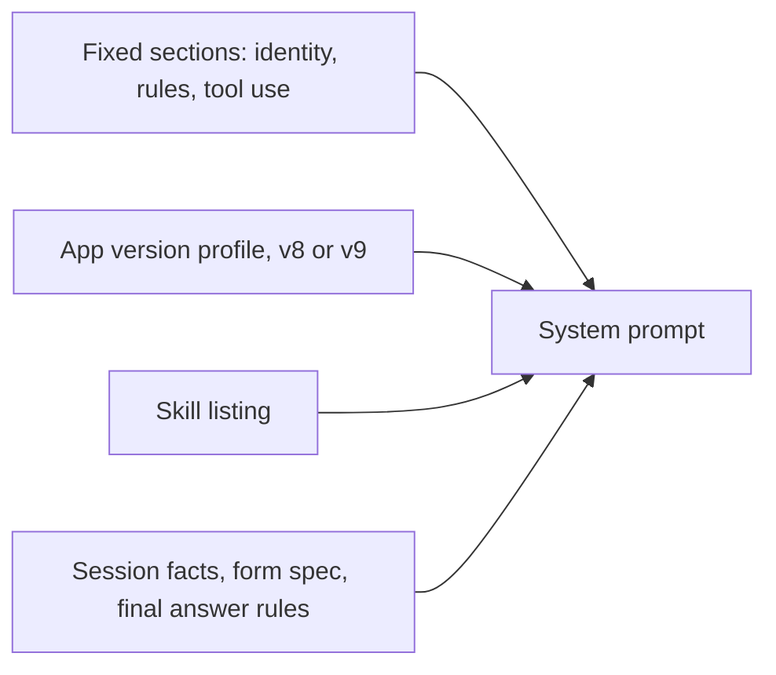
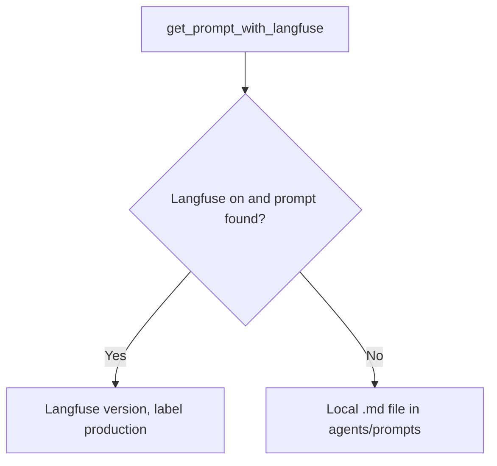

# Prompt and skills

Code: `src/AI/assistant/agents/core/context.py`, `src/AI/assistant/agents/prompts/`, `src/AI/assistant/scripts/sync_prompts.py`

## The loop system prompt

The system prompt of the loop is built in code, from fixed sections and session facts. It explains the four parts of an Altinn app: layouts, data models, text resources and policy. It also lists rules that models often break.

_The parts of the loop system prompt. The final answer rules are different for chat mode and workflow mode._

## Skills

[Assistant skills](../skills.md) says which skills load and how to add one.

## Prompts for the gates, intake and spec

_Prompt loading. The CI workflow `assistant-prompts.yaml` publishes a changed prompt after the merge to main._

For names, publication, drift and retired prompts, refer to [agents/prompts/README.md](../../agents/prompts/README.md).
