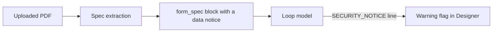

# Security controls

Code: `src/AI/assistant/agents/prompts/intent_security.md`, `src/AI/assistant/agents/core/tools/`, `src/AI/assistant/shared/utils/spotlight.py`, `src/AI/assistant/agents/services/llm/llm_client.py`, `src/AI/assistant/agents/core/context.py`, `src/AI/assistant/infra/kustomize/networkpolicy.yaml`

The security model has four layers. Each layer covers a risk that the other layers do not cover.

**Network access.** A NetworkPolicy blocks connections from pods other than the Designer pods.

**Intent gate.** This layer runs in workflow mode only. It examines the goal text for abuse before the graph starts. It sees the names of the attachments, but not their content. The reason: a large PDF is expensive to examine, and it gives little signal.

**Structural containment.** This layer runs in both modes. It is the boundary that actually stops an attack:

- In chat mode, the loop refuses the write tools until the user gives permission.
- The file tools stay in the app repository.
- App code does not run in the assistant pod. The v9 upgrade and the build in `verify_changes` run MSBuild, which runs code from the app, so the assistant runner (`src/AI/assistant-runner`) runs them in a microVM without secrets.
- `web_fetch` can only get pages from an allowlist of Altinn hosts. This also applies to each redirect.
- Each change goes to a session branch. A person examines the branch before the merge.
- The prompts that Langfuse serves are published by CI after the merge to main, so each served prompt has a reviewed commit.

**Spotlighting.** This layer marks untrusted text, so that the model reads it as data and not as instructions. This layer runs in both modes. It covers the content of uploaded documents, which the intent gate does not see. Document content gets to the model two times: as the attachment that the spec extractor reads, and as the extracted `FormSpec` in the system prompt of the loop. The code puts the two in `<attachment_content>` and `<form_spec>` tags, with a notice that the content is data, not instructions. The code escapes a closing tag in the content, so a document cannot close its block too early.

_The path of a document. The model reports an injection attempt on one line. The code removes the line and sends only a flag._

`src/AI/assistant/shared/utils/spotlight.py` makes the tags. `llm_client.py` applies them to the attachment, and `src/AI/assistant/agents/core/context.py` applies them to the form spec. The control is in code, not in a prompt file. The reason: Langfuse serves the prompts, so a control that is only in a prompt file can disappear after an edit in Langfuse.
