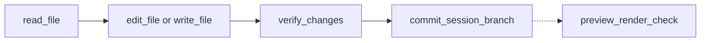
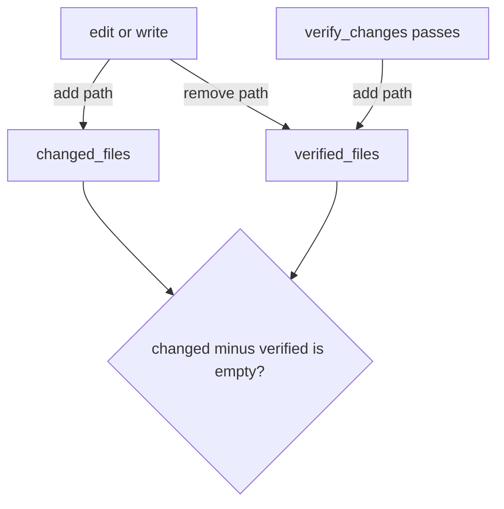
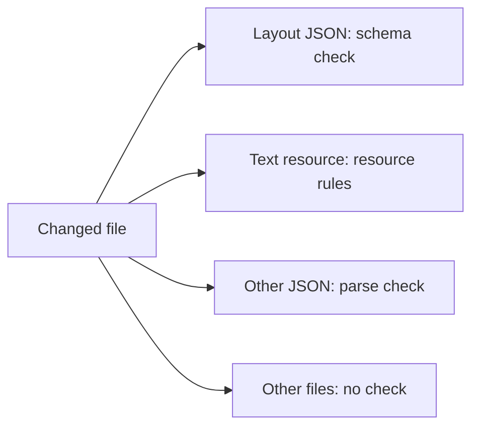

# Tools

Code: `src/AI/assistant/agents/core/tool.py`, `src/AI/assistant/agents/core/registry.py`, `src/AI/assistant/agents/core/tools/`

Each tool is a class with a name, a description, a Pydantic input schema and a `run` method. A tool that changes the app inherits `WriteTool`. This base class refuses the call when the session is read-only, and marks the refusal as one the user can lift. The loop node registers the tools in `_internal_tools()` in `src/AI/assistant/agents/graph/nodes/agentic_loop_node.py`.

| Tool                    | Job                                              | Parallel | Needs write mode |
| ----------------------- | ------------------------------------------------ | -------- | ---------------- |
| `scan_repo`             | List layouts, models, text resources and locales | Yes      | No               |
| `read_file`             | Read one file, or one part of a long file        | Yes      | No               |
| `edit_file`             | Replace one string in one file                   | No       | Yes              |
| `write_file`            | Make or replace a whole file                     | No       | Yes              |
| `discard_file_changes`  | Reset one file to HEAD, or delete a new file     | No       | Yes              |
| `verify_changes`        | Validate all changed files                       | Yes      | Yes              |
| `commit_session_branch` | Commit and push to the session branch            | No       | Yes              |
| `preview_render_check`  | Render each page in a headless browser, if on    | No       | Yes              |
| `skill`                 | Load the full text of one skill                  | Yes      | No               |
| `altinn_layout_props`   | Get the allowed properties of a component type   | Yes      | No               |
| `altinn_datamodel_sync` | Make XSD and C# from a JSON Schema model         | No       | Yes              |
| `web_fetch`             | Get a page from the Altinn docs hosts only       | Yes      | No               |
| `upgrade_app_to_v9`     | Upgrade the app from v8 to v9 in a sandbox       | No       | Yes              |

The loop cuts every tool result at a fixed size, and the model cannot get the cut text back. So `read_file`, `web_fetch` and `skill` return long text in parts. Each part ends with a note that tells the model which lines it has not read, and how to read them. `write_file` refuses to replace a file that the model has read only part of. [`text_parts.py`](../../agents/core/tools/utils/text_parts.py) explains why.

There is no automatic rollback. The model undoes a change with `discard_file_changes`, one file at a time. The file tools refuse absolute paths and `..`, so the model cannot leave the repository. `edit_file` and `write_file` refuse to change an existing file that the model did not read first. They save a valid `.json` file in the format that Studio uses, with two-space indentation. `altinn_datamodel_sync` gets the files from the Designer API at `DESIGNER_BASE_URL`. The model must read a file that this tool wrote again before it changes the file.

`preview_render_check` works only with the local Designer stack, so it is off by default (`PREVIEW_CHECK_ENABLED=false`). When it is off, the loop node does not register it, and the system prompt does not mention it. A model that is told to run a check that cannot run tells the user about it, and the user cannot act on that.

`upgrade_app_to_v9` asks the core operator to run the upgrade in a sandbox Job, and applies the patch that the run returns. It reads the result of the upgrade from the report of the run, and the operator runner has refused symbolic links, submodules, CI workflow folders and git attribute files in the patch. The tool tells the model that it cannot upgrade when the service has no `CORE_OPERATOR_URL`, for example in local development, or when the operator has no sandbox, for example in staging. When the user cancels the session, the tool cancels the run.

The run is for the commit at HEAD, so the tool refuses a working tree with changes. When a run is in progress for the same commit, the operator answers the request with that run. So a request that the service sends again after a timeout starts no second run, and sessions on the same commit of the same repository share a run. A cancel in one of those sessions also stops the upgrade in the other.

_The usual write path. The system prompt tells the model to follow it. The last step is only there when `PREVIEW_CHECK_ENABLED=true`._

_The commit gate. The commit tool refuses if a changed file is not verified after its last edit._

_How `verify_changes` picks a validator. It also checks text keys and page navigation._

`verify_changes` stops a commit only for the errors that the session caused, so the old errors in an app do not stop a correct change. The text resource check and the text key check return each error as a finding: a rule, a location and a message. `verify_changes` does the same checks on the files at the [start commit](git-and-repo.md), not at `HEAD`. The reason: after a commit, `HEAD` has the errors of the session. A finding that the start commit also has is old. It goes into `old_errors`, and the system prompt tells the model to offer a correction. The other checks stop the commit for each error in a changed file.

The location is the name of the item that has the error, for example a text resource ID. A position does not work, because it changes when the session adds a text above it.

An old JSON syntax error in a changed text resource file also stops the commit. The parser stops at the error, so `verify_changes` cannot compare the findings. After the correction, each error in the file is new.
