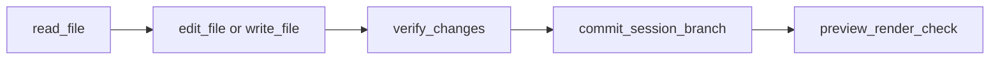
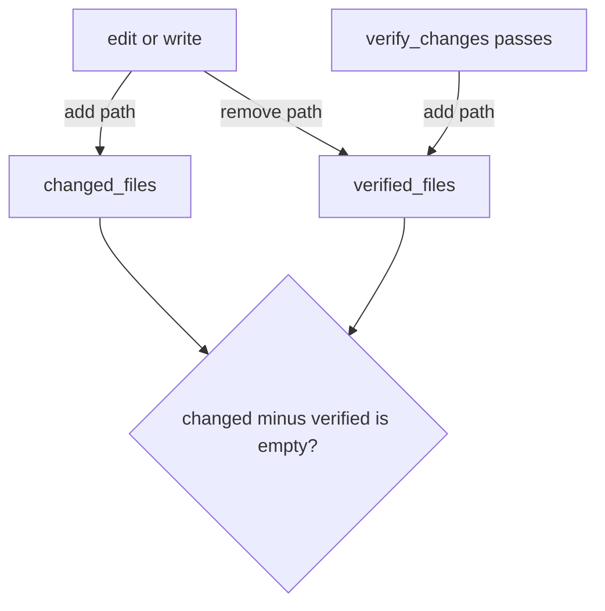
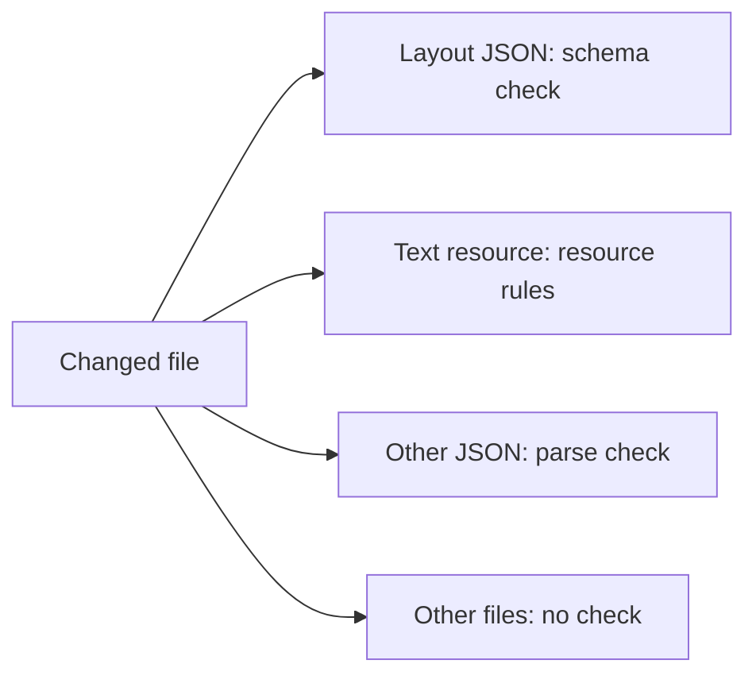

# Tools

Code: `src/AI/assistant/agents/core/tool.py`, `src/AI/assistant/agents/core/registry.py`, `src/AI/assistant/agents/core/tools/`

Each tool is a class with a name, a description, a Pydantic input schema and a `run` method. A tool that changes the app inherits `WriteTool`. This base class refuses the call when the session is read-only, and marks the refusal as one the user can lift. The loop node registers the tools in `_internal_tools()` in `src/AI/assistant/agents/graph/nodes/agentic_loop_node.py`.

| Tool                    | Job                                              | Parallel | Needs write mode |
| ----------------------- | ------------------------------------------------ | -------- | ---------------- |
| `scan_repo`             | List layouts, models, text resources and locales | Yes      | No               |
| `read_file`             | Read one file, or one part of a long file        | Yes      | No               |
| `edit_file`             | Replace one string in one file                   | No       | Yes              |
| `write_file`            | Make or replace a whole file                     | No       | Yes              |
| `discard_file_changes`  | Reset one file to HEAD, or delete a new file     | No       | Yes              |
| `verify_changes`        | Validate all changed files                       | Yes      | Yes              |
| `commit_session_branch` | Commit and push to the session branch            | No       | Yes              |
| `preview_render_check`  | Render each page in a headless browser           | No       | Yes              |
| `skill`                 | Load the full text of one skill                  | Yes      | No               |
| `altinn_layout_props`   | Get the allowed properties of a component type   | Yes      | No               |
| `altinn_datamodel_sync` | Make XSD and C# from a JSON Schema model         | No       | Yes              |
| `web_fetch`             | Get a page from the Altinn docs hosts only       | Yes      | No               |

The loop cuts every tool result at a fixed size, and the model cannot get the cut text back. So `read_file`, `web_fetch` and `skill` return long text in parts, and each part ends with a note that names the lines the model has not read and how to read them. `write_file` refuses to replace a file that the model has read only part of. [`text_parts.py`](../../agents/core/tools/utils/text_parts.py) explains why.

There is no automatic rollback. The model undoes a change with `discard_file_changes`, one file at a time. The file tools refuse absolute paths and `..`, so the model cannot leave the repository. `edit_file` and `write_file` refuse to change an existing file that the model did not read first. They save a valid `.json` file in the format that Studio uses, with two-space indentation. `altinn_datamodel_sync` gets the files from the Designer API at `DESIGNER_BASE_URL`. The model must read a file that this tool wrote again before it changes the file. `preview_render_check` is off by default (`PREVIEW_CHECK_ENABLED=false`) and works only with the local Designer stack.

_The usual write path. The system prompt tells the model to follow it._

_The commit gate. The commit tool refuses if a changed file is not verified after its last edit._

_How `verify_changes` picks a validator. It also checks text keys and page navigation._

`verify_changes` stops a commit only for the errors that the session caused. Thus the old errors in an app do not stop a correct change. A check returns each error as a finding: a rule, a location and a message. `verify_changes` does the same check on the files at the start commit, and compares the findings as multisets. A finding that the start commit also has is old. It goes into `old_errors` and does not stop the commit.

The location is the name of the item that has the error, for example a text resource ID. It is not the position of the item, because the position changes when the session adds a text above it. The start commit is the commit that the session started from. `HEAD` is not sufficient, because `HEAD` contains the errors of the session after the session commits.

An old JSON syntax error is an exception. If the session changes a text resource file that has one, the session must correct the syntax error before it can commit. The JSON parser stops at the syntax error, so `verify_changes` cannot do a check of the file. After the correction, each error in the file is new.

Only the text resource check and the text key check return findings. The other checks stop the commit for each error in a changed file. The system prompt tells the model to show the old errors in its final message and to offer to correct them.
