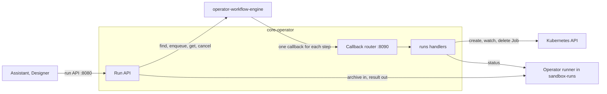

# core-operator

The core operator does work for the services of a Studio cluster that must outlive a request or needs a permission
the services must not hold, such as cluster work. Services ask it through an API and hold no Kubernetes permission of
their own. Each kind of work is a domain: a group of steps that the workflow engine runs. Only one package knows
Kubernetes, so a domain that needs no cluster work fits as well. The
[ADR on the core operator](../../../docs/adr/2026-10-28-core-operator.md) sets the conditions for what belongs here.

Today it runs app code in sandbox Jobs for the assistant and Designer: a caller names a kind from the catalog and the
commit of the app, uploads the app as an archive once the run's Job is ready, and fetches the result. The operator
queues the run, creates the Job, passes the archive and the result on between the caller and the operator runner in the
Job's pod, and deletes the Job.

The operator keeps nothing of a run itself. The workflow engine keeps the run, and the run's Job keeps the archive and
the result. So the operator has no volume, and a caller needs no store of its own: it finds its runs again by their
labels.

## How the parts fit



- The run API in [`internal/runapi`](internal/runapi/runapi.go) serves the callers, as [For callers](#for-callers)
  describes.
- The [operator-workflow-engine](../operator-workflow-engine/README.md) is a host of the workflow engine. It stores
  each run as a workflow in Postgres and runs each step by calling the operator. Retries, waiting, wait budgets and
  cancellation come from the engine, and the workflow's labels and states hold all that the operator knows of a run.
- The [operator runner](../operator-runner/README.md) runs one command in a new microVM in the Job's pod. It keeps the
  archive it received and the result until the caller has fetched it.

The operator runs as one replica, because its queue lives in memory. A restart stops the run API for a few seconds.
Runs in flight continue: the engine retries the step it was on, and the operator runner keeps the result for the caller.

### Packages

| Package                                                                    | What it does                                                                                                                                                                                     |
| -------------------------------------------------------------------------- | ------------------------------------------------------------------------------------------------------------------------------------------------------------------------------------------------ |
| [`internal/kube`](internal/kube)                                           | The one connection to Kubernetes, and the one package that uses controller-runtime and client-go: the manager with leader election and health probes, the run Jobs as a sandbox, and TokenReview |
| [`internal/sandbox`](internal/sandbox/sandbox.go)                          | The contract between the run steps and where a run's Job runs, with no Kubernetes types                                                                                                          |
| [`internal/runs`](internal/runs)                                           | The runs domain: the queue, the workflow, its steps, the run service and the garbage collector                                                                                                   |
| [`internal/runapi`](internal/runapi)                                       | The run API over HTTP                                                                                                                                                                            |
| [`internal/callbacks`](internal/callbacks)                                 | The engine's callbacks, routed to the handlers of each domain                                                                                                                                    |
| [`internal/engine`](internal/engine), [`internal/runner`](internal/runner) | Clients of the workflow engine and of the operator runner                                                                                                                                        |
| [`internal/auth`](internal/auth)                                           | Who a request is from, with a token reviewer that `internal/kube` provides                                                                                                                       |
| [`internal/logging`](internal/logging/logging.go)                          | A `logr` logger for each package, from the context or the process                                                                                                                                |

A new domain gets its own package beside `internal/runs`, its own handler group and its own engine namespaces. If it
needs cluster work, it states what it needs as a contract like `internal/sandbox`, and `internal/kube` implements it.

## Identities

| Who        | ServiceAccount                                                            | May use               |
| ---------- | ------------------------------------------------------------------------- | --------------------- |
| Assistant  | `system:serviceaccount:default:altinn-altinity-agents-sa`                 | Run API, `upgrade-v9` |
| Designer   | `system:serviceaccount:default:altinn-designer`                           | Run API, `upgrade-v9` |
| The engine | `system:serviceaccount:operator-workflow-engine:operator-workflow-engine` | Callback API          |

Each sends a projected ServiceAccount token with the audience `core-operator` as a bearer token. The operator checks
it with a TokenReview and maps the user name to a caller in its configuration. No new secret exists, and the callers
mount no token for the Kubernetes API.

## A run, step by step

Each run is one workflow in the engine, in the namespace `runs-<caller>`. One namespace for each caller keeps the runs
of callers apart in the engine's lists and dashboard, and lets the engine's per-namespace throttling isolate callers if
it is turned on. It is off today, because every step calls the same operator.

The workflow has the labels `runId`, `kind` and `caller`, and the run's own labels, which say what the run is for. Each
kind lists the keys of its labels in the catalog, and a create sends a value for each key and no other. A caller finds
its runs again by them, and a dashboard can count runs by them. The command never gets the labels, and labels hold no
personal data, since they show in the engine's dashboard.

`upgrade-v9` has the labels `org`, `app`, `repoOwner`, `repo` and `commit`. The org and the app come from the app's id,
and the owner and the name of the repository from Gitea. They are not always the same, such as for a copy of an app in a
user's own repositories. A kind that is not about an app has other labels, such as the org alone.

The workflow's initial state has what the run uses of its kind: the namespace, the PodTemplate, the command, whether it
requires an archive and the timeouts. Each step passes the state on and adds what it learned,
such as the pod's address. A run keeps its kind to its end, so a change to the catalog applies to new runs, and the
Job's deadline fits the budgets of the run's workflow. The queue uses the current limits of the kind, and fails a queued
run whose kind has left the catalog.

Each step is an operator command with a `commandKey`:

| Step                | What the operator does                                                                                                               | Defers while            |
| ------------------- | ------------------------------------------------------------------------------------------------------------------------------------ | ----------------------- |
| `run.admit`         | Admits the run when it is among the oldest that fit under the limits of its kind                                                     | the run is queued       |
| `run.create-job`    | Creates the Job `run-<runId>` from the kind's PodTemplate. An existing Job is success.                                               | the quota is full       |
| `run.await-pod`     | Waits for the pod to be ready. A failed pod fails the run. For a kind that requires no archive, starts the command                   | the pod is not ready    |
| `run.await-archive` | Only for a kind that requires an archive: waits until the caller's archive has reached the operator runner, which starts the command | no archive has come     |
| `run.await-result`  | Reads the operator runner's status until the command has ended, and keeps the outcome                                                | the command runs        |
| `run.cleanup`       | Deletes the Job once the operator runner has handed over the result, or the result timeout                                           | the result is not taken |

A kind sets `requiresArchive: true` when its command runs on the files of the caller's archive, as `upgrade-v9` does.
A kind without it has no `run.await-archive`. The operator runner starts a run with an archive, so `run.await-pod`
sends it an empty one once the pod is ready. Such a run goes from `starting` to `running`, and an upload answers 409.

A step that waits answers with a deferral, so the engine calls it again later and the step holds no worker while it
waits. The wait budget of each step bounds how long it may wait. When the queue timeout or the upload timeout has run
out, the engine calls the step a last time, and the step fails the run itself, with an error that the status reads as
`expired` or as `archive-timeout`.

The operator runner's status read does not count as a fetch, so `run.await-result` learns the outcome and leaves the
result to the caller. Once the caller has fetched it, the operator runner keeps it for 30 seconds more, for a fetch that
broke off, and exits. `run.cleanup` sees the pod end and deletes the Job.

### Creating a run

A create finds the caller's run of the same kind with the same labels, if it has not ended, and answers with it. A
completed run whose Job still has the result has not ended, so a caller that comes back finds the run and fetches the
result. A create after the run has ended makes a new run.

The run id is a UUIDv5 of the caller and a key of the kind, the labels and the newest run of them that has ended. Two
creates at the same time build the same workflow with the same key, and the engine stores it once. The engine leaves the
context out of its idempotency hash and hashes the initial state, so two creates with the same key and another version
of the kind are a conflict. A lock in the operator serializes the creates of the same labels, so the engine's answer is the backstop
for a second replica.

### The queue

The queue lives in the operator's memory. A run holds a place in the sandbox from its admission until its Job finishes,
and the queue counts the run Jobs in the kind's namespace for this. Until the Job exists, the run holds its place with a
reservation, which `run.create-job` and `run.await-pod` renew. The ResourceQuota in
[src/core/operator-runner/infra](../operator-runner/infra/kustomize) does not replace the queue: its KVM, CPU and memory
limits apply to pods, so it accepts a Job too many, whose pod then waits. CI runners use the same sandbox nodes.

A run holds its place while it waits for the caller's archive and while the operator runner keeps its result, so a slow
caller holds back the runs behind it, up to the upload timeout and the result timeout.

After a restart the queue is empty. While the operator was down, the engine's retry backoff grew, so a run may take
up to the longest retry delay to call again. The queue admits no one for that long, plus a recheck, after the operator
starts to serve callbacks. By then each queued run has called `run.admit` and each admitted run has renewed its
reservation, so no run passes an older one and the limits hold. The place of a run is the time the engine created its
step, which does not change with the restart.

### The archive and the result

The operator passes the archive on to the operator runner as it arrives, and passes the result on to the caller as the
operator runner sends it. It holds neither in memory nor on disk. The operator runner takes the first archive that
arrives whole, and discards one that comes again for the same run.

The result can be fetched for 5 minutes after the run ended, the operator runner's `RESULT_RETENTION_SECONDS`, and for
30 seconds after the first fetch. Then the operator runner exits, `run.cleanup` deletes the Job, and the result request
answers with 410. The engine keeps the workflow for 14 days, so a caller still gets the status. The garbage collector
deletes the Jobs of runs that ended without `run.cleanup`, such as canceled runs.

The operator passes `report` on without reading it, so a new kind with its own report needs no change here.

## For callers

The assistant and Designer both run `upgrade-v9`, the assistant from its chat and Designer from buttons in its UI. Each
sees only its own runs.

- **Create.** Send the kind and its labels. For `upgrade-v9` they are the app's org and name, the repository's owner and
  name, and the commit that you will upload. Create again after a timeout or a restart: the operator answers with the
  run in progress.
- **Find.** After a restart, `GET /api/v1/runs?labelSelector=repoOwner=…,repo=…,commit=…` lists your runs of that
  commit, newest first. You need no store of your own.
- **Follow.** `GET /api/v1/runs/{id}?wait=25` answers when the status or the queue position changes, or after 25
  seconds. A UI can long-poll through a stateless endpoint of its service, so a redeploy of the service does not stop
  it. `queuePosition`, `startedAt` and the timeouts of the kind from `GET /api/v1/kinds` are enough to show progress.
- **Upload.** When the status is `awaiting-archive`, send a gzip tar of the app at the commit, without `.git`, with
  `PUT /api/v1/runs/{id}/archive`. Start within `uploadTimeoutSeconds`, and send the whole archive within 2 minutes.
  You can build the archive then, from the commit, so you need not keep it from the create. An upload that broke off
  can be sent again.
- **Fetch the result** as soon as the status is `completed`, by `resultExpiresAt`. Keep what you show later, such as
  the report, in your own store, or in the commit that applies the patch.
- **Give up.** The operator gives each run a final status within the `maxDurationSeconds` of its kind in
  `GET /api/v1/kinds`, which counts every retry the engine allows. A caller that has seen no final status by then can
  give up on the run, rather than keep its own copy of the operator's budgets.
- **Retry.** The engine already retries the steps that fail for a while, such as a pod that is not ready. `failed` and
  `expired` are final: create again for a new run. `completed` means that the command ran. Whether it did what you
  wanted is in the `report` or the exit code, and the same app gives the same result again.
- **Apply the patch** with `git apply`. The operator runner has refused symbolic links, submodules, CI workflows and git
  attribute files, and `git apply` refuses paths outside the repository.

Two callers of the same service that work on the same commit share its run, since the operator knows the service and
not the user. A cancel from one cancels it for both.

The report of `upgrade-v9` is the output of `studioctl app upgrade v9 --json`, as in
[this example](../operator-runner/examples/upgrade-v9-report.json):

- `exitCode` is 0 when the app was upgraded, 3 when it was upgraded and has manual steps left, 2 when it is not on a
  version that the upgrade starts from, and anything else when the upgrade failed.
- `steps` lists each step of the upgrade with its messages. A message has the status `OK`, `INFO`, `SKIP`, `WARN`,
  `TODO` or `FAIL`.
- When the patch leaves `App/ui/layout-sets.json` in the app, layouts still need manual work, and the upgrade is not
  done. Do not apply part of it: the assistant then discards the whole patch and shows the `TODO` messages as what
  blocks the upgrade.

## Callback contract

The engine sends `POST /workflow-engine-callbacks/{commandKey}` to the callback port for each step.

```json
{
  "commandKey": "run.admit",
  "context": { "domain": "runs", "caller": "assistant", "subjectId": "0b6f…" },
  "workflowId": "…",
  "stepId": "…",
  "executionReferenceTime": "2026-11-03T10:00:00+00:00",
  "state": null,
  "retryCount": 0,
  "executionDeadline": "2026-11-03T10:00:30+00:00",
  "deferCount": 0,
  "firstDeferredAt": null,
  "waitDeadline": null,
  "isFinalWaitCheck": false
}
```

The operator answers:

- 2xx with an empty body, or `{"state": "…"}`, when the step is done. `state` reaches the next step as its `state`.
- 2xx with `{"state": "…", "defer": {"delay": "00:00:05", "reason": "queued"}}` when the step waits. `delay` is a
  .NET `TimeSpan` in the constant format `[d.]hh:mm:ss[.fffffff]`.
- 4xx, other than 408, 418 and 429, when the step must fail without a retry.
- 5xx, 408 or 429 when the engine should retry the step.

`stepId` is the same for every attempt of a step, so a handler can use it as the idempotency key for a call it must not
repeat. The operator decodes only the fields that its handlers read, so the engine may send more.

## Develop

The [Makefile](Makefile) has the checks that CI runs: `make fmt`, `make lint`, `make test` and `make build`.
`make manifests` builds the overlays in [config](config).

- `make test` downloads a Kubernetes API server for envtest the first time. One envtest applies the PodTemplate and the
  admission policy from [src/core/operator-runner/infra](../operator-runner/infra/kustomize/base), and checks that the
  API server accepts the Jobs the operator builds. Change those files and the Job builder together.
- The tests of the run steps use an in-memory engine, operator runner and sandbox, in `internal/engine/enginetest`,
  `internal/runner/runnertest` and `internal/sandbox/sandboxtest`. The tests of `internal/kube` cover the Kubernetes
  side with a fake API server, and the envtest above. The contract tests read the callback examples in
  [api/callbacks](api/callbacks).
- `make run` runs the operator against the cluster in your kubeconfig, without leader election. Set
  `CORE_OPERATOR_CONFIG_DIR` to a folder with the configuration.

The configuration is the YAML files of a ConfigMap, read in name order. [config/base](config/base/config.yaml) names the
callers, and the overlays of the environments with sandbox nodes add the kinds in `kinds.yaml`. Staging has no sandbox
nodes, so its catalog is empty. [internal/config](internal/config/config.go) has the defaults.

The image builds from `src/`, for the shared Go module in [src/common/go](../../common/go). The
[deploy workflow](../../../.github/workflows/deploy-core-operator.yaml) pins the image in the Deployment and pushes
[config](config) as the Flux artifact that
[infra/studio/syncroot](../../../infra/studio/syncroot/base/core-operator.yaml) deploys.

## Later: run events

Today a caller sees a run's status while it runs, and its output only when it ends. A kind whose command talks while it
runs needs more. An example is a turn of the assistant on pi, which
[altinn-studio#21855](https://github.com/Altinn/altinn-studio/issues/21855) analyses: Designer shows the turn's text and
status lines as they come. Events fit without a change to what exists:

- The operator runner's command declares that it writes events, as it declares its report file. The operator runner
  numbers the events, keeps them until it exits, and serves those after a number that the client gives.
- The operator reads the events from the operator runner, as it reads the result, so the sandbox needs no route to the
  cluster. It passes them on unread at `GET /api/v1/runs/{id}/events`, as it passes on the report. Their shape belongs
  to the kind.
- The events do not go through the engine. Each callback carries the workflow's state, so events there would make
  every callback larger.
- A rollout of the operator breaks the stream for a few seconds. The caller asks again from the last event it has. This
  works because the operator runner keeps the events, not the operator.

A turn also changes what makes two creates the same run. A create for a kind with the labels of a run in progress
answers with that run. That is right for `upgrade-v9`, where two callers want the same result, but two chat threads on
the same commit each need their own run. A kind for a turn has a label for the thread, which keeps them apart.

The issue also asks for the model key to be added outside the VM and for a fast start. Those are separate from the
events.

## Later: Maskinporten clients

Maskinporten client provisioning lives in the runtime operator today. It can move here without new plumbing:

- The callback router keeps one handler for each `commandKey`, grouped by domain (`run.*` now, `maskinporten.*`
  later). The configuration turns groups on, so the same binary can run as a second Deployment with its own
  ServiceAccount and workload identity. The Maskinporten supplier key then stays out of the pod that creates Jobs.
- Each domain gets its own engine namespaces, so the engine's per-namespace throttling protects the Maskinporten API.
- The run API keeps its paths under `/api/v1/runs`. A Maskinporten API would add `/api/v1/maskinporten-clients`.

A sketch of how it could work, for the ADR that decides it. It keeps the operator out of the domain: Designer maps an
app to a client, and the operator only sees opaque keys, scopes and a place to put the key.

- Designer owns the intent: which clients exist, their scopes, and where each private key goes. When it deploys an
  app, it calls `PUT /api/v1/maskinporten-clients/{clientKey}` with the scopes and the delivery target, and `DELETE`
  when the app is removed. `clientKey` is Designer's name for the client, and the operator does not interpret it.
- The operator enqueues a workflow in the namespace `maskinporten-<caller>`, keyed on the client key and a hash of the
  request, so a repeated deploy with the same scopes changes nothing. The steps:
  - `maskinporten.ensure-client` finds the client by its key, or creates it, and sets its scopes.
  - `maskinporten.ensure-key` makes a key pair and uploads the public key.
  - `maskinporten.deliver-key` writes the private key to the delivery target, such as a secret in the Key Vault that
    the runtime operator syncs into the app.
  - `maskinporten.prune-keys` removes keys that are no longer in use.
- A sweep on the leader enqueues a rotation workflow for each key that reaches its rotation age, because the engine
  has no recurring workflows yet.
- The crypto code, the self-service API client and the planner that decides the changes move from the runtime
  operator's `internal/` into `src/common/go`, so both operators can use them. Designer sends the names of the existing
  clients as their keys, so the operator adopts them, and the runtime operator stops managing them one ring at a time.
- The ADR must decide how a key reaches a runtime cluster, who owns the supplier client, and how app pods restart
  after a rotation.
