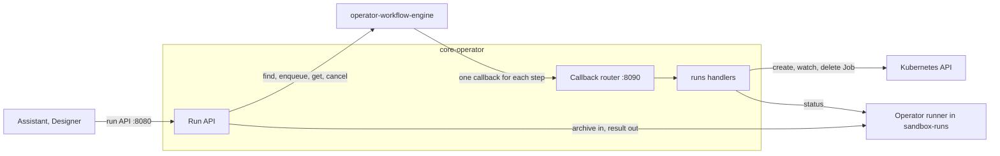

# core-operator

The core operator does work for the services of a Studio cluster that must outlive a request, or that needs a
permission the services must not hold, such as cluster work. Services call its API and hold no Kubernetes permission of
their own. The [ADR on the core operator](../../../docs/adr/2026-10-28-core-operator.md) sets the conditions for what
belongs here.

Today it runs app code in sandbox Jobs for the assistant and Designer. A caller names a kind from the catalog, uploads
the app as an archive once the run's Job is ready, and fetches the result. The operator queues the run, creates the
Job, passes the archive and the result between the caller and the operator runner in the Job's pod, and deletes the
Job.

The operator keeps nothing of a run. The workflow engine keeps the run, and the Job keeps the archive and the result.
So the operator has no volume, and a caller needs no store of its own: it finds its runs by their labels.

## How the parts fit

- The operator-workflow-engine is a host of the workflow engine. It stores each run as a workflow in Postgres and
  calls the operator for each step. The engine supplies the retries, the waits, the wait budgets and the cancellation.
  The workflow's labels and states hold all that the operator knows of a run.
- The [operator runner](../operator-runner/README.md) runs one command in a new microVM in the Job's pod. It keeps the
  archive and the result until the caller has fetched the result.

The operator runs as one replica, because its queue lives in memory. A restart stops the run API for a few seconds.
Runs in flight continue: the engine retries the step it was on, and the operator runner keeps the result.

Each kind of work is a domain, such as [`internal/runs`](internal/runs), with its own group of callback handlers and
its own engine namespaces. Only [`internal/kube`](internal/kube) uses Kubernetes. A domain that needs cluster work
states it as a contract with no Kubernetes types, such as [`internal/sandbox`](internal/sandbox/sandbox.go), and
`internal/kube` implements it.

## Identities

| Who        | ServiceAccount                                                            | May use               |
| ---------- | ------------------------------------------------------------------------- | --------------------- |
| Assistant  | `system:serviceaccount:default:altinn-altinity-agents-sa`                 | Run API, `upgrade-v9` |
| Designer   | `system:serviceaccount:default:altinn-designer`                           | Run API, `upgrade-v9` |
| The engine | `system:serviceaccount:operator-workflow-engine:operator-workflow-engine` | Callback API          |

Each sends a projected ServiceAccount token with the audience `operator` as a bearer token. The operator checks
it with a TokenReview and maps the user name to a caller in its configuration. So no new secret exists, and the callers
mount no token for the Kubernetes API.

## A run, step by step

Each run is one workflow in the engine, in the namespace `runs-<caller>`. One namespace for each caller keeps the runs
of callers apart in the engine's lists and dashboard. It would also let the engine's
[failure-storm throttling](../../../docs/adr/2026-08-13-workflow-engine-failure-throttling.md) isolate callers, if the
engine host turned it on.

The workflow has the labels `runId`, `kind` and `caller`, and the run's own labels, which say what the run is for. The
catalog lists the label keys of each kind, and a create sends a value for each key and no other. A caller finds its
runs by them, and a dashboard can count runs by them. The command never gets the labels. Labels hold no personal data,
because the engine's dashboard shows them.

`upgrade-v9` has the labels `org`, `app`, `repoOwner`, `repo` and `commit`. The org and the app come from the app's id,
and the repository's owner and name from Gitea. They can differ, such as for a copy of an app in a user's own
repositories.

The workflow's initial state has what the run uses of its kind. Each step passes the state on and adds what it learned,
such as the pod's address. A run keeps its kind to its end, so a change to the catalog applies to new runs. The queue
uses the kind's current limits, and fails a queued run whose kind has left the catalog.

Each step is an operator command with a `commandKey`:

| Step                | What the operator does                                                                                    | Defers while            |
| ------------------- | --------------------------------------------------------------------------------------------------------- | ----------------------- |
| `run.admit`         | Admits the run when it is among the oldest that fit under the limits of its kind                          | the run is queued       |
| `run.create-job`    | Creates the Job `run-<runId>` from the kind's PodTemplate                                                 | the quota is full       |
| `run.await-pod`     | Waits for the pod to be ready, or fails the run. For a kind without an archive, starts the command        | the pod is not ready    |
| `run.await-archive` | For a kind with an archive: waits until the archive reaches the operator runner, which starts the command | no archive has come     |
| `run.await-result`  | Reads the operator runner's status until the command has ended, and keeps the outcome                     | the command runs        |
| `run.cleanup`       | Deletes the Job once the operator runner has handed over the result, or at the result timeout             | the result is not taken |

A kind sets `requiresArchive: true` when its command runs on the files of the caller's archive, as `upgrade-v9` does.
A run of a kind without it goes from `starting` to `running`, and an upload answers 409.

A step that waits answers with a deferral, so the engine calls it again later and the step holds no worker. The wait
budget of each step bounds how long it may wait. When the queue timeout or the upload timeout has run out, the engine
calls the step a last time, and the step fails the run itself. The run's status then says why: `expired` or
`archive-timeout`.

### Creating a run

A create answers with the caller's run of the same kind and labels, if that run has not ended. A completed run whose
Job still has the result has not ended, so a caller that comes back can fetch the result. A create after the run has
ended makes a new run.

The run id is a UUIDv5 of the caller and a key of the kind, the labels and the newest of their runs that has ended. So
two creates at the same time build the same workflow, and the engine stores it once. A lock in the operator serializes
the creates of the same labels. The engine's idempotency key is the backstop for a second replica.

### The queue

The queue lives in the operator's memory. A run holds a place in the sandbox from its admission until its Job finishes.
Until the Job exists, the run holds its place with a reservation, which `run.create-job` and `run.await-pod` renew. The
queue admits as many runs as the ResourceQuota in [src/core/operator-runner/infra](../operator-runner/infra/kustomize)
has KVM slots. The quota cannot replace the queue: its limits apply to pods, so it accepts one Job too many, whose pod
then waits. CI runners use the same sandbox nodes.

A run holds its place while it waits for the caller's archive and while the operator runner keeps its result. So a
slow caller holds back the runs behind it, up to the upload timeout and the result timeout.

After a restart the queue is empty, and it admits no run during a warmup. The warmup gives every queued run the time
to call `run.admit` again, and every admitted run the time to renew its reservation. So no run passes an older one and
the limits hold. A run's place is the time the engine created its step, which a restart does not change.

### The archive and the result

The operator streams the archive to the operator runner and the result to the caller. It keeps neither in memory nor
on disk. The operator runner takes the first archive that arrives whole, and discards a repeat.

The status read of `run.await-result` does not count as a fetch, so the operator runner keeps the result for the
caller. The caller can fetch the result until the operator runner
[exits](../operator-runner/README.md#when-the-operator-runner-exits). Then `run.cleanup` deletes the Job, and a fetch
answers 410. The engine keeps the workflow longer, so the caller still gets the status. The garbage collector deletes
the Jobs of runs that ended without `run.cleanup`, such as canceled runs.

The operator passes `report` on without reading it, so a new kind with its own report needs no change here.

## For callers

The assistant and Designer both run `upgrade-v9`, the assistant from its chat and Designer from its UI. Each sees only
its own runs.

- **Create.** Send the kind and its labels. For `upgrade-v9` these are the app's org and name, the repository's owner
  and name, and the commit that you will upload. After a timeout or a restart, create again: the operator answers with
  the run in progress.
- **Find.** `GET /api/v1/runs?labelSelector=repoOwner=…,repo=…,commit=…` lists your runs of that commit, newest first.
  You need no store of your own.
- **Follow.** `GET /api/v1/runs/{id}?wait=25` answers when the status or the queue position changes, or after 25
  seconds. A UI can long-poll through a stateless endpoint of its service, so a redeploy of the service does not stop
  it. `queuePosition`, `startedAt` and the kind's timeouts from `GET /api/v1/kinds` are enough to show progress.
- **Upload.** When the status is `awaiting-archive`, send a gzip tar of the app at the commit, without `.git`, with
  `PUT /api/v1/runs/{id}/archive`. Send the whole archive within `uploadTimeoutSeconds`, and each attempt within 2
  minutes. At the upload timeout, the operator cuts off the upload and the run fails with `archive-timeout`. You can
  build the archive at this point from the commit. You can send an upload that broke off again.
- **Fetch the result** as soon as the status is `completed`, before `resultExpiresAt`. It is `null` once the result is
  gone. Keep what you show later, such as the report, in your own store or in the commit that applies the patch.
- **Give up.** The operator gives each run a final status within the `maxDurationSeconds` of its kind in
  `GET /api/v1/kinds`, which counts every retry of the engine. If you have seen no final status by then, give up on
  the run. Do not keep your own copy of the operator's budgets.
- **Retry.** The engine already retries the steps that fail for a while, such as a pod that is not ready. `failed` and
  `expired` are final: create again for a new run. `completed` means that the command ran. The `report` or the exit
  code says whether it did what you wanted, and the same app gives the same result again.
- **Apply the patch** with `git apply`. The operator runner [checks the patch](../operator-runner/README.md#the-patch)
  first.

Two callers of the same service that work on the same commit share its run, because the operator knows the service and
not the user. A cancel from one cancels the run for both.

The report of `upgrade-v9` is the output of `studioctl app upgrade v9 --json`, as in
[this example](../operator-runner/examples/upgrade-v9-report.json):

- `exitCode` is 0 when the app was upgraded, 3 when it was upgraded and has manual steps left, 2 when it is not on a
  version that the upgrade starts from, and any other value when the upgrade failed.
- When the patch leaves `App/ui/layout-sets.json` in the app, the layouts need manual work and the upgrade is not done.
  Do not apply part of the patch. The assistant discards the whole patch and shows the `TODO` messages as what blocks
  the upgrade.

## Callback contract

The engine sends `POST /workflow-engine-callbacks/{commandKey}` to the callback port for each step, with a payload such
as [payload.json](testdata/callbacks/payload.json).

The operator answers:

- 2xx with an empty body, or `{"state": "…"}`, when the step is done. `state` reaches the next step as its `state`.
- 2xx with `{"state": "…", "defer": {"delay": "00:00:05", "reason": "queued"}}` when the step waits. `delay` is a
  .NET `TimeSpan` in the constant format `[d.]hh:mm:ss[.fffffff]`.
- 422 with a problem such as [response-end.json](testdata/callbacks/response-end.json) when the step must fail without a
  retry. The engine keeps the problem as the step's error, and the run's status reads the reason from it.
- 503 when the engine should retry the step. For other answers, the engine's `NonRetryableHttpStatusCodes` decide.

`stepId` is the same for every attempt of a step, so a handler can use it as the idempotency key for a call it must not
repeat. The operator decodes only the fields that its handlers read, so the engine may send more.

## Telemetry

- `altinn.core_operator.run.duration` times each run from its create to its final status, by kind, caller, status and
  reason. Its count is the number of runs that ended. It counts only the ends that the operator sees. A run that the
  engine fails on its own, when the retries of a step run out, shows only in the engine's
  `altinn.workflow_engine.workflow.execution.failed`.
- `altinn.core_operator.queue.wait.duration` times each run from its create to its admission.
- The operator's spans of a run carry its id as `altinn.core_operator.subject_id`, as the engine's spans of the run's
  workflow do.
- Before the operator deletes a run's Job, it logs the operator runner's warnings and errors, because the pipeline
  collects no container logs.

## Develop

The [Makefile](Makefile) has the checks that CI runs. `make manifests` builds the overlays in [config](config).

- `make test` downloads a Kubernetes API server for envtest the first time. One envtest applies the PodTemplate and the
  admission policy from [src/core/operator-runner/infra](../operator-runner/infra/kustomize/base), and checks that the
  API server accepts the Jobs that the operator builds. Change those files and the Job builder together.
- The tests of the run steps call each step as the engine does, with an in-memory operator runner and sandbox. No test
  simulates the engine: the fake engine in `internal/engine/enginetest` only stores workflows. The contract tests read
  the callback examples in [testdata/callbacks](testdata/callbacks) and the operator runner's
  [protocol examples](../operator-runner/examples/protocol.json).
- `make run` runs the operator against the cluster in your kubeconfig. Set `CORE_OPERATOR_CONFIG_DIR` to a folder with
  the configuration.

The configuration is the YAML files of a ConfigMap, read in name order. [config/base](config/base/config.yaml) names the
callers, and the overlays of the environments with sandbox nodes add the kinds in `kinds.yaml`.
[internal/config](internal/config/config.go) has the defaults.

The image builds from `src/`, for the shared Go module in [src/common/go](../../common/go). The
[deploy workflow](../../../.github/workflows/deploy-core-operator.yaml) pins the image in the Deployment and pushes
[config](config) as the Flux artifact that
[infra/studio/syncroot](../../../infra/studio/syncroot/base/core-operator.yaml) deploys.

## Later: run events

Today a caller sees a run's status while it runs, and its output only when it ends. A kind whose command reports while
it runs needs events. An example is a turn of the assistant on pi, where Designer shows the turn's text as it comes
([altinn-studio#21855](https://github.com/Altinn/altinn-studio/issues/21855)). Events fit without a change to what
exists:

- The command declares that it writes events, as it declares its report file. The operator runner numbers the events,
  keeps them until it exits, and serves those after a number that the client gives.
- The operator reads the events from the operator runner, as it reads the result, so the sandbox needs no route to the
  cluster. It passes them on unread at `GET /api/v1/runs/{id}/events`.
- The events do not go through the engine. Each callback carries the workflow's state, so events there would make
  every callback larger.
- After a rollout of the operator, the caller asks again from its last event. This works because the operator runner
  keeps the events, not the operator.

Two chat threads on the same commit each need their own run, so a kind for a turn has a label for the thread.

## Later: Maskinporten clients

Maskinporten client provisioning can move here from the runtime operator without new plumbing:

- The callback router groups its handlers by domain (`run.*` now, `maskinporten.*` later), and the configuration
  turns groups on. So the same binary can run as a second Deployment with its own ServiceAccount and workload
  identity, and the Maskinporten supplier key stays out of the pod that creates Jobs.
- Each domain has its own engine namespaces, so the engine's failure-storm throttling can protect the Maskinporten API.
- A Maskinporten API adds `/api/v1/maskinporten-clients` beside `/api/v1/runs`.

This sketch is input for the ADR that decides it. The operator stays out of the domain: Designer maps an app to a
client, and the operator sees only opaque keys, scopes and a place to put the key.

- Designer owns the intent: the clients, their scopes, and where each private key goes. When it deploys an app, it
  calls `PUT /api/v1/maskinporten-clients/{clientKey}` with the scopes and the delivery target. It calls `DELETE` when
  it removes the app.
- The operator enqueues a workflow in the namespace `maskinporten-<caller>`, keyed on the client key and a hash of the
  request, so a repeated deploy with the same scopes changes nothing. The steps:
  - `maskinporten.ensure-client` finds or creates the client, and sets its scopes.
  - `maskinporten.ensure-key` makes a key pair and uploads the public key.
  - `maskinporten.deliver-key` writes the private key to the delivery target, such as a Key Vault secret that the
    runtime operator syncs into the app.
  - `maskinporten.prune-keys` removes keys that are no longer in use.
- A sweep in the operator enqueues a rotation workflow for each key at its rotation age, because the engine has no
  recurring workflows yet.
- The crypto code, the self-service API client and the planner move from the runtime operator into `src/common/go`.
  Designer sends the names of the existing clients as their keys, so the operator adopts them, and the runtime
  operator stops managing them one ring at a time.
- The ADR must decide how a key reaches a runtime cluster, who owns the supplier client, and how app pods restart
  after a rotation.
